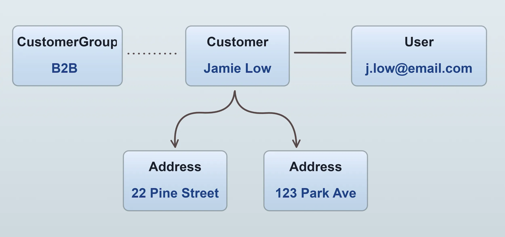

A [`Customer`](/reference/typescript-api/entities/customer/) is a person who can buy from your shop. A customer can have one or more
[`Addresses`](/reference/typescript-api/entities/address/), which are used for shipping and billing.

If a customer has registered an account, they will have an associated [`User`](/reference/typescript-api/entities/user/). The user
entity is used for authentication and authorization. **Guest checkouts** are also possible, in which case a customer will not have a user.

:::info
See the [User Management](/core-concepts/user-management/) guide for a detailed explanation of the relationship between
customers and users.
:::



Customers can be organized into [`CustomerGroups`](/reference/typescript-api/entities/customer-group/). These groups can be used in
logic relating to promotions, shipping rules, payment rules etc. For example, you could create a "VIP" customer group and then create
a promotion which grants members of this group free shipping. Or a "B2B" group which is used in a custom tax calculator to
apply a different tax rate to B2B customers.

## Separate customer bases per Channel

By default, all Channels share one customer base. An email address identifies one Customer across the whole
instance, and a Customer who registers on one Channel can log in on any other.

When one Vendure instance hosts independent storefronts, such as several brands, you may want each storefront
to have its own customers. Configure an [`IdentityScopeStrategy`](/reference/typescript-api/auth/identity-scope-strategy/)
to do this:

```ts title="src/vendure-config.ts"
import { ChannelIdentityScopeStrategy, VendureConfig } from '@vendure/core';

export const config: VendureConfig = {
    authOptions: {
        identityScopeStrategy: new ChannelIdentityScopeStrategy(),
    },
    // ...
};
```

The strategy assigns each Channel an **identity scope**. Channels with the same scope share one customer base.
Within a scope, an email address belongs to at most one Customer. The same email address on two Channels in
different scopes is two independent Customers, each with their own password, profile, addresses and orders.

Every Customer is stored with the scope of the Channel it was created on (`Customer.identityScope`). These
operations are then limited to the scope of the active Channel:

- Registration, login and guest checkout. A guest checkout on one storefront no longer fails with an
  `EmailAddressConflictError` because the email address is registered on another.
- Password reset, account verification and email address changes. A token issued on one storefront cannot be
  used on another.
- Logins through external [authentication strategies](/core-concepts/auth/) that use
  `ExternalAuthenticationService.findCustomerUser()` and `createCustomerAndUser()`.

A session belongs to one scope. On a Channel in another scope, it is treated as a guest session.

Administrators are not scoped. An Administrator logs in with the same credentials on every Channel, and their
access is controlled by their [role assignments](/core-concepts/roles/).

:::info
"An account exists for this email address" means: a registered Customer with this email address exists in the
scope of the active Channel. Accounts in other scopes are not visible to the storefront, so a storefront cannot
use registration, password reset or guest checkout to find out whether an email address is registered on
another storefront.
:::

### Grouping Channels into one customer base

`ChannelIdentityScopeStrategy` gives every Channel its own customer base. To let several Channels share one, for
example the regional Channels of a brand, write your own strategy. The strategy receives the Channel with its own
columns, including `sellerId` and custom fields, and returns a key:

```ts title="src/seller-identity-scope-strategy.ts"
import { Channel, IdentityScopeStrategy } from '@vendure/core';

// Each Seller has one customer base across all of its Channels.
export class SellerIdentityScopeStrategy implements IdentityScopeStrategy {
    getIdentityScope(channel: Channel) {
        return `seller:${channel.sellerId}`;
    }
}
```

The key is stored on each Customer, so it must not change for a Channel once that Channel has Customers.
Base it on values which do not change, such as the Channel or Seller id. If the key depends on a value an
administrator can edit, such as a custom field, Vendure refuses an update to that value which would move a
Channel with Customers to another scope.

### The default Channel

Every Customer is also listed on the default Channel, so that an administrator there can see all Customers.
That listing does not let a Customer act on the default Channel. With `ChannelIdentityScopeStrategy`, the default
Channel is a storefront with its own customer base, like any other Channel.

In the Dashboard, the customer list and detail page show the storefronts each Customer belongs to. A Customer
belongs to the customer base of the Channel it is created on, so switch to the right Channel before you create
one.

### Changing the strategy on an existing install

Existing Customers are stored in the `global` scope. Before you switch to another strategy, move them into the
new scopes with the [`migrateCustomerIdentityScopes()`](/reference/typescript-api/migration/migrate-customer-identity-scopes/)
helper in a database migration. Run it with `dryRun: true` first to see what it will change. A Customer who used
Channels in several scopes is split into one Customer per scope, so they can still log in everywhere with the
same password.

The server checks on startup that the stored scopes match the configured strategy. It refuses to start if the
Customers of a Channel are all in a different scope, for example because the migration was not run.
