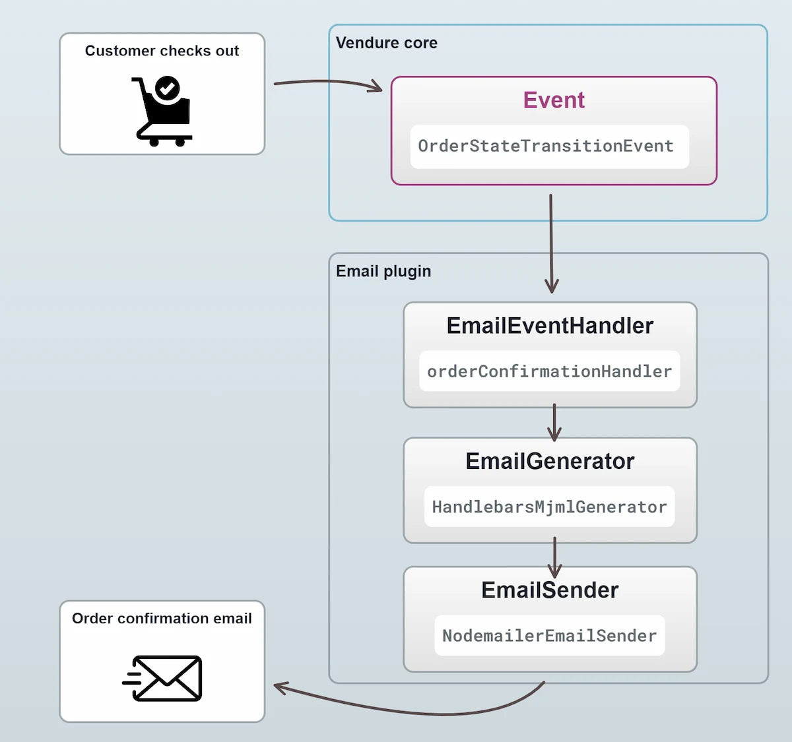

A typical ecommerce application needs to notify customers of certain events, such as when they place an order or
when their order has been shipped. This is usually done via email, but can also be done via SMS or push notifications.

## Email

Email is the most common way to notify customers of events, so a default Vendure installation includes our [EmailPlugin](/reference/core-plugins/email-plugin).

The EmailPlugin renders emails from [React](https://react.dev/) templates using [React Email](https://react.email/),
and by default uses [Nodemailer](https://nodemailer.com/about/) to send them via a variety of
different transports, including SMTP, SendGrid, Mailgun, and more.
The plugin is configured with a list of [EmailEventHandlers](/reference/core-plugins/email-plugin/email-event-handler) which are responsible for
sending emails in response to specific events.

:::note
This guide will cover some of the main concepts of the EmailPlugin, but for a more in-depth look at how to configure
and use it, see the [EmailPlugin API docs](/reference/core-plugins/email-plugin).
:::

Here's an illustration of the flow of an email being sent:



All emails are triggered by a particular [Event](/developer-guide/events/) - in this case when the state of an
Order changes. The EmailPlugin ships with a set of [default email handlers](https://github.com/vendurehq/vendure/blob/master/packages/email-plugin/src/handler/default-email-handlers.ts),
one of which is responsible for sending "order confirmation" emails.

### EmailEventHandlers

Let's take a closer look at a simplified version of the `orderConfirmationHandler`:

```ts
import { EntityHydrator, OrderStateTransitionEvent } from '@vendure/core';
import {
    EmailEventListener,
    OrderConfirmationEmail,
    shippingLinesWithMethod,
    transformOrderLineAssetUrls,
} from '@vendure/email-plugin';

// The 'order-confirmation' string identifies this type of email, e.g. in the
// dev tooling and to template loaders.
export const orderConfirmationHandler = new EmailEventListener('order-confirmation')
    .on(OrderStateTransitionEvent)
    // Only send the email when the Order is transitioning to the
    // "PaymentSettled" state and the Order has a customer associated with it.
    .filter(
        event =>
            event.toState === 'PaymentSettled'
            && !!event.order.customer,
    )
    // We commonly need to load some additional data to be able to render the email
    // template. This is done via the `loadData()` method. Here we load the relations
    // the template displays, and make the product image URLs absolute.
    .loadData(async ({ event, injector }) => {
        await injector.get(EntityHydrator).hydrate(event.ctx, event.order, {
            relations: ['lines.featuredAsset', 'shippingLines.shippingMethod'],
        });
        transformOrderLineAssetUrls(event.ctx, event.order, injector);
        return { shippingLines: shippingLinesWithMethod(event.order) };
    })
    // Here we are setting the recipient of the email to be the
    // customer's email address.
    .setRecipient(event => event.order.customer!.emailAddress)
    // We can interpolate variables from the EmailPlugin's configured
    // `globalTemplateVars` object.
    .setFrom('{{ fromAddress }}')
    // We can also interpolate variables made available by the
    // `setTemplateVars()` method below
    .setSubject('Order confirmation for #{{ order.code }}')
    // The object returned here is passed to the template as its props.
    .setTemplateVars(event => ({ order: event.order, shippingLines: event.data.shippingLines }))
    // The React template which renders the email.
    .setTemplate(OrderConfirmationEmail)
```

To recap:

- The handler listens for a specific event
- It optionally filters those events to determine whether an email should be sent
- It specifies the details of the email to be sent, including the recipient, subject, template variables and template

The full range of methods available when setting up an EmailEventHandler can be found in the [EmailEventHandler API docs](/reference/core-plugins/email-plugin/email-event-handler).

### Email variables

In the example above, we used the `setTemplateVars()` method to define the variables which are available to the email template.
Additionally, there are global variables which are made available to _all_ email templates & EmailEventHandlers. These are
defined in the `globalTemplateVars` property of the EmailPlugin config:

```ts title="src/vendure-config.ts"
import { VendureConfig } from '@vendure/core';
import { EmailPlugin } from '@vendure/email-plugin';

export const config: VendureConfig = {
    // ...
    plugins: [
        EmailPlugin.init({
            // ...
            globalTemplateVars: { // [!code highlight]
                fromAddress: '"MyShop" <noreply@myshop.com>', // [!code highlight]
                verifyEmailAddressUrl: 'https://www.myshop.com/verify', // [!code highlight]
                passwordResetUrl: 'https://www.myshop.com/password-reset', // [!code highlight]
                changeEmailAddressUrl: 'https://www.myshop.com/verify-email-address-change', // [!code highlight]
                adminPasswordResetUrl: 'https://my-server.com/dashboard/reset-password', // [!code highlight]
                branding: { // [!code highlight]
                    name: 'MyShop', // [!code highlight]
                    logoUrl: 'https://www.myshop.com/logo.png', // [!code highlight]
                    primaryColor: '#0b7285', // [!code highlight]
                    footerText: 'MyShop Ltd, 1 High Street, London', // [!code highlight]
                }, // [!code highlight]
            }, // [!code highlight]
        }),
    ],
};
```

:::note
The `adminPasswordResetUrl` variable is used by the `adminPasswordResetHandler` (one of the default email handlers since v3.8.0)
and should point to the password reset page of your Dashboard. If it is not set, the reset link in the
"admin-password-reset" email will not work.
:::

### Email templates

The default handlers come with templates for every default email. They are styled through the `branding` variable
shown above: the shop name or logo is shown in the header, the `primaryColor` is used for buttons and highlights,
and the `footerText` in the footer. For most shops, setting `branding` is all the customization needed.

To change the content of an email, write your own template. A template is a React component, created with
`defineEmailTemplate()`, which receives the email's template variables as its props. Build it from the components
exported by `@vendure/email-plugin`, or from any [React Email component](https://react.email/docs/components/html):

```tsx title="src/email/order-confirmation.tsx"
import {
    defineEmailTemplate,
    EmailBranding,
    EmailHeading,
    EmailLayout,
    EmailOrder,
    EmailSection,
    EmailShippingLine,
    EmailText,
    OrderHighlights,
    OrderSummary,
} from '@vendure/email-plugin';

export const MyOrderConfirmationEmail = defineEmailTemplate<{
    order: EmailOrder;
    shippingLines: EmailShippingLine[];
    branding?: EmailBranding;
}>(({ order, shippingLines, branding }) => (
    <EmailLayout title="Order Receipt" preview={`Thanks for order ${order.code}`} branding={branding}>
        <EmailSection>
            <EmailText>Thanks for shopping with us, {order.customer?.firstName}!</EmailText>
        </EmailSection>
        <OrderHighlights order={order} />
        <EmailSection>
            <EmailHeading>What you ordered</EmailHeading>
            <OrderSummary order={order} shippingLines={shippingLines} />
        </EmailSection>
    </EmailLayout>
));
```

Then set it on the handler:

```ts title="src/vendure-config.ts"
import { defaultEmailHandlers, EmailPlugin, orderConfirmationHandler } from '@vendure/email-plugin';
import { MyOrderConfirmationEmail } from './email/order-confirmation';

EmailPlugin.init({
    handlers: [
        ...defaultEmailHandlers.filter(h => h !== orderConfirmationHandler),
        orderConfirmationHandler.setTemplate(MyOrderConfirmationEmail),
    ],
    // ...
}),
```

Your `tsconfig.json` needs `"jsx": "react-jsx"`, and its `include` must cover `.tsx` files. Projects created with
`@vendure/create` already have both.

Things to know when writing templates:

- **The props are plain data.** Template variables pass through the job queue before the email is rendered, so dates
  arrive as ISO strings and entity getters (like `order.totalWithTax`) are plain properties. The component props of the
  order components (`EmailOrder`, `EmailOrderLine`, ...) describe the data they need.
- **Formatting follows the email's language.** `Money` and `FormattedDate` format amounts and dates in the language of the email.
- **Translating text.** Use the `useEmailContext()` hook to read the `languageCode` (and `channelCode`) of the email being rendered.
- **Plain text.** A plain text version is generated from the HTML. Use `setPlainTextBody()` on the handler to write your own.
- **Subject and "from".** These may contain `{{ path.to.value }}` placeholders. For anything more, pass a function to `setSubject()`.

To load templates from somewhere other than your code, for example to let staff edit them, configure a
[TemplateLoader](/reference/core-plugins/email-plugin/template-loader). Templates returned by a loader take precedence
over the template set on the handler.

:::note
Before v4, templates were Handlebars/MJML files. These still work but are deprecated. See
[Email templates](/developer-guide/migrating-from-v3/email-templates) in the v4 migration guide.
:::

### Developing and testing emails

In development, run the EmailPlugin in dev mode. Instead of sending emails, it records every email in an outbox, and
serves a dev mailbox at the given route:

```ts title="src/vendure-config.ts"
EmailPlugin.init({
    devMode: true,
    route: 'mailbox',
    outputPath: path.join(__dirname, '../static/email/test-emails'),
    handlers: defaultEmailHandlers,
    // ...
}),
```

With the server and worker running, the `vendure email` CLI commands render and send emails, and show what was sent.
They use the data in your database, so you don't need to trigger the real event to see an email:

```bash
# The email types and where their sample data comes from
npx vendure email list

# Render an email without sending it. Prints the subject and recipient,
# and writes the HTML and text to files.
npx vendure email render order-confirmation
npx vendure email render order-confirmation --language de --arg order=XN4P3TQ8

# Send an email through the real pipeline (filters, loadData, job queue,
# worker, transport) and wait until it arrives in the outbox
npx vendure email send password-reset --to me@example.com

# Render every email type in each language, and fail if any template errors
npx vendure email check --language en,de
```

To check that an action sends an email, perform the action (for example a GraphQL mutation), then wait for the email:

```bash
npx vendure email outbox --to customer@example.com --since 5m --wait 15
```

The command exits with code 1 if no email arrives in time.

The commands are designed to be used by coding agents as well as people. When their output is not a terminal, they
print JSON, and a failure names the stage it happened at: for example `filter` if a handler's filter rejected the
event, `loadData` if `loadData()` threw, or `queue` if no worker processed the email.

Enable the commands by adding `@vendure/email-plugin` to the CLI plugins in your `package.json`. Projects created
with `@vendure/create` already have this:

```json title="package.json"
{
    "vendure": {
        "cli": {
            "plugins": ["@vendure/email-plugin"]
        }
    }
}
```

#### Sample data for your own handlers

The dev tooling needs an event to render an email from. The default handlers build one from your database: for
example, the order confirmation uses the most recently placed order, or the one you name with `--arg order=CODE`.
Give your own handlers the same with `setSampleEvent()`:

```ts
const orderShippedHandler = new EmailEventListener('order-shipped')
    .on(FulfillmentStateTransitionEvent)
    // ...
    .setSampleEvent(async ({ ctx, injector, args }) => {
        const fulfillment = await injector
            .get(TransactionalConnection)
            .getRepository(ctx, Fulfillment)
            .findOne({ where: args.id ? { id: args.id } : {}, order: { createdAt: 'DESC' } });
        return fulfillment
            ? new FulfillmentStateTransitionEvent('Pending', 'Shipped', ctx, fulfillment)
            : undefined;
    });
```

The event is only used to render the email, so it is safe to set placeholder values on it (such as a sample token),
as long as you don't save them.

### Email integrations

The EmailPlugin is designed to be flexible enough to work with many different email services. The default
configuration uses Nodemailer to send emails via SMTP, but you can easily configure it to use a different
transport. For instance:

- [AWS SES](https://www.vendure.io/marketplace/aws-ses)
- [SendGrid](https://www.vendure.io/marketplace/sendgrid)

## Other notification methods

The pattern of listening for events and triggering some action in response is not limited to emails. You can
use the same pattern to trigger other actions, such as sending SMS messages or push notifications. For instance,
let's say you wanted to create a plugin which sends an SMS message to the customer when their order is shipped.

:::note
This is just a simplified example to illustrate the pattern.
:::

```ts title="src/plugins/sms-plugin/sms-plugin.ts"
import { OnModuleInit } from '@nestjs/common';
import { PluginCommonModule, VendurePlugin, EventBus } from '@vendure/core';
import { OrderStateTransitionEvent } from '@vendure/core';

// A custom service which sends SMS messages
// using a third-party SMS provider such as Twilio.
import { SmsService } from './sms.service';

@VendurePlugin({
    imports: [PluginCommonModule],
    providers: [SmsService],
})
export class SmsPlugin implements OnModuleInit {
    constructor(
        private eventBus: EventBus,
        private smsService: SmsService,
    ) {}

    onModuleInit() {
        this.eventBus
            .ofType(OrderStateTransitionEvent)
            .filter(event => event.toState === 'Shipped')
            .subscribe(event => {
                this.smsService.sendOrderShippedMessage(event.order);
            });
    }
}
```
