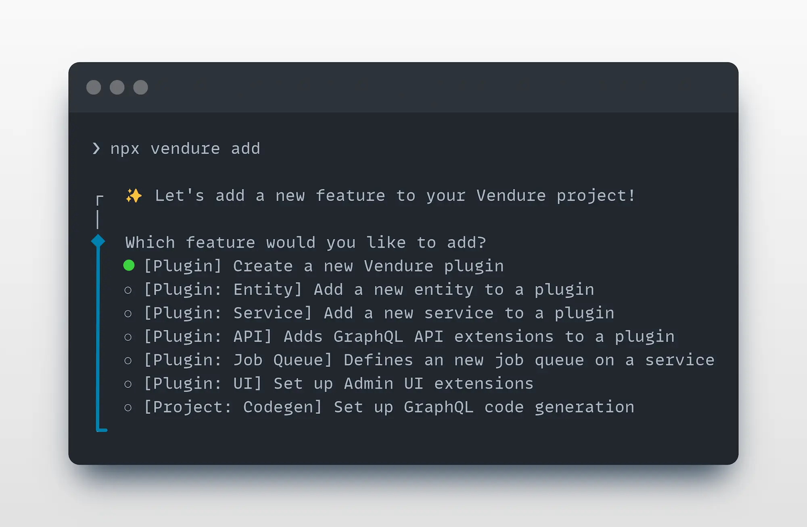
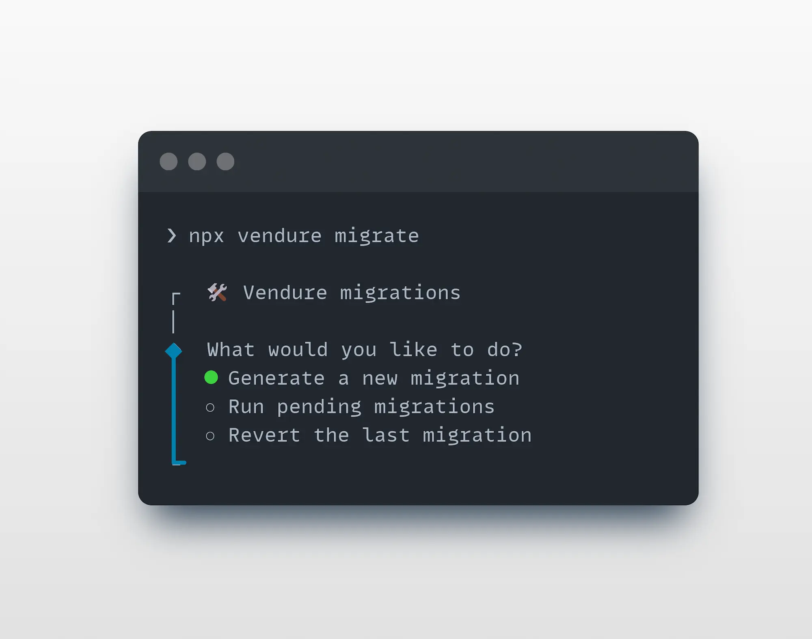
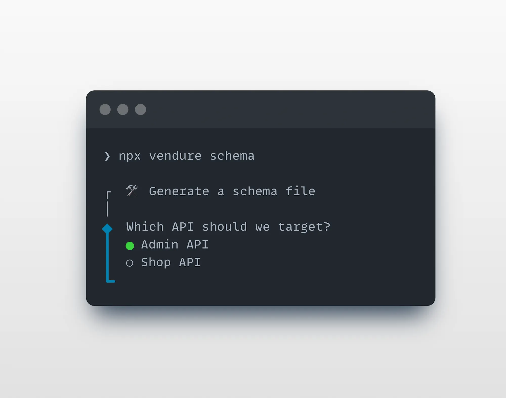

The Vendure CLI is a command-line tool for boosting your productivity as a developer by automating common tasks
such as creating new plugins, entities, API extensions and more.

It is much more than just a scaffolding tool - it is able to analyze your project and intelligently modify your existing
codebase to integrate new functionality.

## Installation

:::info
The Vendure CLI comes installed with a new Vendure project by default from v2.2.0+
:::

To manually install the CLI, run:

```bash
npm install -D @vendure/cli
```

## Interactive vs Non-Interactive Mode

The Vendure CLI supports both **interactive** and **non-interactive** modes:

- **Interactive mode**: Provides guided prompts and menus for easy use during development
- **Non-interactive mode**: Allows direct command execution with arguments and options, perfect for automation, CI/CD, and AI agents

For guidance on using the CLI together with project instructions for AI coding agents, see the
[AI-assisted development guide](/guides/developer-guide/ai-assisted-development/).

## JSON Output for Scripts and Agents

`doctor`, the `add` commands, `migrate generate`, `migrate run`, `migrate revert`, the `devserver`
commands, `explain`, `commands` and `guide` accept `--json`. With `--json`, the command
writes exactly one JSON document to stdout, and sends everything else, including output from libraries
and the processes it starts, to stderr:

```json
{ "schemaVersion": 1, "status": "ok", "output": {}, "notices": [] }
```

`status` is one of:

| Status       | Meaning                                                                                       | Exit code |
| ------------ | --------------------------------------------------------------------------------------------- | --------- |
| `ok`         | The command finished. `output` holds its result                                               | 0         |
| `failed`     | The command finished, and its checks did not pass, for example a failed `doctor` check        | 1         |
| `incomplete` | The command needs something before it can run. `needs` lists it                               | 3         |
| `error`      | The command could not run. `error` holds a `code`, a `message` and structured `fixes`         | 1 or more |

A need is one of:

- `input`: a required field is missing. It names the `field`, and lists the valid `choices` when the
  command can work them out, such as the plugins in your project.
- `consent`: the command would do something destructive. It names the `consent`, shows a `preview` of
  what would happen, and carries a `digest`. Pass the digest as the value of that consent, for example
  `--revert-migration <digest>`, and run the same command again. If what the command would do has changed
  since, it asks again.
- `person`: a step only a person can take. It gives a `url`.

`--input <json>` passes all of a command's options as one JSON document, and `--input -` reads that
document from stdin. Options set as flags win over the same field in the document.

Options go after the full command path: `vendure auth status --json`, not `vendure auth --json status`.
For the groups of commands declared with `defineCommand`, such as `vendure auth`, an option before the
end of the path stops the run with the `cli.option-before-command` error, which names the corrected
command line.

A missing secret field, such as the `token` of a credential, is listed by name, with the `--input`
document on stdin as the way to pass it, so that its value is not put on a command line. When a need has
a fix, the CLI shows its command line, such as `vendure auth login --json`.

The CLI prompts only when stdin and stdout are both terminals, and neither `CI` nor
`VENDURE_CLI_NON_INTERACTIVE` is set. Otherwise a missing required option returns `incomplete` at once.

While it runs, a command writes events to stderr as one JSON object per line, each tagged
`"vendure": "event"`, so a script can tell them apart from other output.

`vendure commands --json` lists these commands, with the JSON Schema of each one's input and output.

`vendure guide` prints a short guide for coding agents: how to run commands with `--json`, answer
`incomplete` results, use the dev server, and when to use the Developer MCP (`vendure mcp`) or the
Store MCP. It ships with the CLI, so it always matches the installed version. The `vendure-cli` agent
skill (`npx skills add vendurehq/vendure --skill vendure-cli`) points agents to it.

## The Dev Command

The `dev` command runs the server, worker and Dashboard in development mode. Use a target to run one process:

```bash
npx vendure dev
npx vendure dev server
npx vendure dev --dir server
npx vendure dev server --dir ./apps/backend
```

`server` in `vendure dev server` selects the server process. `--dir <dir>` selects the project directory.
Relative project paths are resolved against the working directory. Entry files and the Vite config are resolved
from the selected project.

The command resolves the project in this order:

1. Use `--dir <dir>` if supplied. The directory must have a `package.json` with `@vendure/core` in
   `dependencies` or `devDependencies`. An invalid path stops the command.
2. Use the working directory if its `package.json` depends on `@vendure/core`.
3. Search members declared in the working directory's `package.json` `workspaces` field. Both
   `["server"]` and `{ "packages": ["server"] }` are supported, with `*` wildcards such as `apps/*`.
4. Search immediate members of `packages`, `apps`, `libs`, `services` and `modules` in that order.

If more than one declared workspace member depends on `@vendure/core`, the command lists the candidates and
asks you to select one with `--dir`. If no project is found, the error names the searched directory and
`--dir`.

For a workspace with `"workspaces": ["server"]`, run `vendure dev` or `vendure dev server` from the root.
Running from inside `server/` also works.

The CLI reads `--dir` before it loads plugins and parses the full `dev` command. It reads the plugin
allowlist from the selected project's `package.json` and resolves plugin packages from that project.
A plugin must still be a direct project dependency and declare `vendure.cliPlugin` or
`vendure.commandManifest`.
Workspace project discovery also selects the plugin allowlist for other CLI commands. Their own project
validation and actions keep their existing behavior. From a project subdirectory, plugin lookup walks up
to the project directory.


| Option | Description |
| --- | --- |
| `--dir <dir>` | Select the Vendure project directory before discovery. |
| `--server-entry <path>` | Server entry file. Default: `./src/index.ts`. |
| `--worker-entry <path>` | Worker entry file. Default: `./src/index-worker.ts`. |
| `--vite-config <path>` | Dashboard Vite config file. Default: Vite config discovery. |
| `--inspect [host:port]` | Enable the Node.js inspector for the server and worker. |
| `--inspect-brk [host:port]` | Enable the inspector and pause before user code starts. |
| `--no-reload` | Disable automatic server and worker restarts. |
| `--reload-ignored-paths <path...>` | Paths whose changes never restart the server or the worker. |

`vendure dev` runs until you stop it, so it is not a Developer MCP tool: agents use the `devserver`
commands below. With `--json`, the output of the processes goes to stderr as `output` events while the run lasts, and the
envelope is written when it ends. Stopping it with Ctrl+C is a normal end, with exit code 0.

When a backend file changes, `vendure dev` restarts the server and the worker once. A compile error or a
failed start does not end the run: it reports the error and restarts the process on the next save.
Changes under `.vendure/` and under the `gqlOutputPath` of the Dashboard Vite config do not cause a restart.

A run that starts the server keeps its state in a state file, which the `devserver` commands read. On macOS
and Linux it is `.vendure/devserver.json` in the project directory. On Windows it is
`%LOCALAPPDATA%\Vendure\devserver\<hash>.json` in your user profile, one file per project directory. On
macOS and Linux the file has mode 0600, so only your user can read it. On Windows it takes the permissions of
your profile's `%LOCALAPPDATA%`, which by default only you, SYSTEM and administrators can read. The file is
deleted when the run stops. The server and the worker
log as JSON, and every line of output goes to `.vendure/logs/dev.jsonl`. The terminal still shows readable
text. The log rotates at 10 MB and keeps three files.

## The Devserver Commands

The `devserver` commands run `vendure dev` in the background and report on it, for scripts and coding agents.
`vendure mcp` offers them as tools too. Run them in the project directory.

```bash
# Start the server, worker and Dashboard in the background, and wait until they are ready
npx vendure devserver start

# Status, URLs, restart count and the last error, with file, line and message for a compile error
npx vendure devserver status --json

# Wait until the run is ready. Returns at once if it failed
npx vendure devserver wait --timeout 60 --json

# Read the log: recent lines, one request, or warnings and errors
npx vendure devserver logs --since 15m --min-severity warn
npx vendure devserver logs --request <request-id> --json

npx vendure devserver stop
```

To run a GraphQL operation on the running dev server, use `vendure api`. `admin` runs it on the Admin API as the
superadmin, with no credentials needed. `shop` runs it on the Shop API anonymously, like a storefront, and each call
is a new session. A response with errors exits with code 1, and each error keeps its `extensions`, including the
`requestId`:

```bash
npx vendure api admin '{ products(options: { take: 5 }) { items { id name } } }' --json
npx vendure api shop 'query ($id: ID!) { product(id: $id) { name } }' --variables '{"id":"1"}' --json
```

`--operation-name` picks one operation from a document that holds several, and `--channel-token` sends the
`vendure-token` header for another channel. A project that sets `apiOptions.channelTokenKey` to another header
name ignores `--channel-token`.

| Command | Description |
| --- | --- |
| `devserver start [target]` | Start `vendure dev` in the background, for the target `all` (the default) or `server`. It waits until the run is ready or failed, except under `vendure mcp`. `--no-wait` returns once the run has started. It refuses to start while another run serves the project. |
| `devserver status` | Report `starting`, `ready`, `restarting`, `failed` or `stopped`, with the URLs, the start time, the restart count and the last error. |
| `devserver wait` | Wait until the run is ready, and return at once when it failed or stopped. `--after-restarts <n>` waits for the restart an edit causes: pass the `restarts` that `status` reported before the edit, plus 1. |
| `devserver logs` | Read `.vendure/logs/dev.jsonl`, filtered with `--since` (a duration such as `15m`, or an ISO 8601 time), `--request <id>` and `--min-severity`. It returns the newest 1000 lines that match. |
| `devserver stop` | Stop the run and wait until it has exited. |

Each request has an ID, which the server returns in the `x-request-id` header and in the extensions of a
GraphQL error. A job that a request adds carries the same ID, so `--request` finds the log lines of the
request and of the jobs it started.

`vendure explain <request-id>` collects what the log holds for one request: the error, with its code,
message and stack, and every log line of the request. Take the ID from the `x-request-id` header or from
`extensions.requestId` of a GraphQL error:

```bash
npx vendure explain 2b0c6c2e-5f6a-4a0e-9d1b-7f0d3c1e8a42 --json
```

## The Add Command

The `add` command is used to add new entities, resolvers, services, plugins, and more to your Vendure project.

### Interactive Mode

From your project's **root directory**, run:

```bash
npx vendure add
```



The CLI will guide you through the process of adding new functionality to your project.

The `add` command is much more than a simple file generator. It is able to
analyze your project source code to deeply understand and correctly update your project files.

The first entry, "Vendure Platform features (B2B, advanced search, ...), free trial", links the project to Vendure Console with `vendure console link`, opens the free trial page of the Console Project in your browser, and then runs `npx @vendure-platform/create@latest add` to install the Vendure Platform packages. You can cancel at each step. The CLI makes no network call before you select this entry. `npx vendure add --platform` starts the same flow, and needs an interactive terminal.

### Non-Interactive Mode

Each feature is its own subcommand, so you can run it from a script or an agent:

```bash
# Create a new plugin, and add it to the Vendure config
npx vendure add plugin my-feature

# Add an entity to a plugin
npx vendure add entity MyEntity --plugin MyFeaturePlugin

# Add an entity with features
npx vendure add entity MyEntity --plugin MyFeaturePlugin --custom-fields --translatable

# Add a basic service to a plugin
npx vendure add service MyService --plugin MyFeaturePlugin

# Add a CRUD service for an entity
npx vendure add service MyEntityService --plugin MyFeaturePlugin --entity MyEntity

# Add a job queue to a service
npx vendure add job-queue --plugin MyFeaturePlugin --service MyService --name my-job

# Add an Admin API extension. A CRUD service gets the entity's queries and mutations
npx vendure add api-extension --plugin MyFeaturePlugin --service MyEntityService

# For any other service, name the query, the mutation, or both
npx vendure add api-extension --plugin MyFeaturePlugin --service MyService --query-name getCustomData

# Add Dashboard extensions to a plugin
npx vendure add dashboard --plugin MyFeaturePlugin

# Add GraphQL codegen to a plugin
npx vendure add codegen --plugin MyFeaturePlugin
```

Every subcommand supports `--json`. Without a required input, it returns `incomplete` and names the
missing fields, with the valid values, such as the plugins of your project, as `choices`. On a
terminal, it asks for them instead.

The flags in the table below are the older form of the same commands. They still work, and run the
subcommands above.

#### Older Add Command Flags

| Flag | Long Form                  | Description                        | Example                                                                  |
| ---- | -------------------------- | ---------------------------------- | ------------------------------------------------------------------------ |
|      | `--platform`               | Start the Platform trial flow      | `vendure add --platform`                                                 |
| `-p` | `--plugin <n>`             | Create a new plugin                | `vendure add -p MyPlugin`                                                |
| `-e` | `--entity <n>`             | Add a new entity to a plugin       | `vendure add -e MyEntity --selected-plugin MyPlugin`                     |
| `-s` | `--service <n>`            | Add a new service to a plugin      | `vendure add -s MyService --selected-plugin MyPlugin`                    |
| `-j` | `--job-queue [plugin]`     | Add job queue support              | `vendure add -j MyPlugin --name job-name --selected-service ServiceName` |
| `-a` | `--api-extension [plugin]` | Add API extension scaffold         | `vendure add -a MyPlugin --selected-service MyService --query-name getName` |
| `-d` | `--dashboard [plugin]`     | Add Dashboard extensions setup     | `vendure add -d MyPlugin`                                                |
|      | `--config <path>`          | Custom Vendure config file, used with `-p` | `vendure add -p my-plugin --config ./custom-config.ts`          |

#### Sub-options for specific commands

**Entity (`-e`) additional options:**

- `--selected-plugin <n>`: Name of the plugin to add the entity to (required)
- `--custom-fields`: Add custom fields support to the entity
- `--translatable`: Make the entity translatable

**Service (`-s`) additional options:**

- `--selected-plugin <n>`: Name of the plugin to add the service to (required)
- `--selected-entity <n>`: An entity of the plugin. The service then has CRUD methods for it

**Job Queue (`-j`) additional options:**

- `--name <name>`: Name for the job queue (required)
- `--selected-service <name>`: Service to add the job queue to (required)

**API Extension (`-a`) additional options: (requires either)**

- `--selected-service <n>`: The service the resolver calls (required)
- `--query-name <n>`: Name for the GraphQL query
- `--mutation-name <n>`: Name for the GraphQL mutation

:::info
**Validation**: Entity and service commands validate that the specified plugin exists in your project. If the plugin is not found, the command will list all available plugins in the error message. Both commands require the `--selected-plugin` parameter when running in non-interactive mode.
:::

## The Migrate Command

The `migrate` command is used to generate and manage [database migrations](/developer-guide/migrations) for your Vendure project.

### Interactive Mode

From your project's **root directory**, run:

```bash
npx vendure migrate
```



### Non-Interactive Mode

For migration operations, use specific arguments and options:

```bash
# Generate a new migration
npx vendure migrate generate my-migration-name

# Run pending migrations
npx vendure migrate run

# Revert the last migration, after showing what it reverts and asking first
npx vendure migrate revert

# Generate migration with custom output directory
npx vendure migrate generate my-migration --output-dir ./custom/migrations

# Generate a complete baseline migration against an empty shadow database
npx vendure migrate generate initial --from-empty
```

`generate`, `run` and `revert` support `--json`, which writes one JSON document to stdout. The older
flags `-g <name>` and `-r` run the same commands as `generate` and `run`.

#### Migrate Command Options

| Flag | Long Form             | Description                            | Example                                           |
| ---- | --------------------- | -------------------------------------- | ------------------------------------------------- |
| `-g` | `--generate <name>`   | Generate a new migration               | `vendure migrate -g add-user-table`               |
| `-r` | `--run`               | Run all pending migrations             | `vendure migrate -r`                              |
| `-o` | `--output-dir <path>` | Custom output directory for migrations | `vendure migrate -g my-migration -o ./migrations` |
|      | `--from-empty`        | Generate a complete baseline migration by diffing against an empty [shadow database](/developer-guide/migrations/#generating-a-baseline-migration-for-an-existing-project) | `vendure migrate -g initial --from-empty` |

### Reverting a Migration

`vendure migrate revert` shows which config, database and migration a revert would undo, and asks you
to confirm. With `--json`, it returns `incomplete` with a `revertMigration` consent need instead:

```bash
npx vendure migrate revert --json
# → "needs": [{ "kind": "consent", "consent": "revertMigration", "digest": "c9bedc6757cd4396", "preview": { ... } }]

npx vendure migrate revert --json --revert-migration c9bedc6757cd4396
# → "status": "ok", "output": { "reverted": true, "migration": "First1795182600577" }
```

The digest belongs to that preview. If the last applied migration or the database changes in between, the
command asks again. When the database has applied no migration, nothing is reverted and no consent is
needed.

## The Schema Command

:::info
The `schema` command was added in Vendure v3.5
:::

The `schema` command allows you to generate a schema file for your Admin or Shop APIs, in either the GraphQL schema definition language (SDL)
or as JSON.

This is useful when integrating with GraphQL tooling such as your [IDE's GraphQL plugin](/getting-started/graphql-intro/#ide-plugins).

### Interactive Mode

From your project's **root directory**, run:

```bash
npx vendure schema
```



### Non-Interactive Mode

To automate or quickly generate a schema in one command

```bash
# Create a schema file in SDL format for the Admin API
npx vendure schema --api admin

# Create a JSON format schema of the Shop API
npx vendure schema --api shop --format json
```

#### Schema Command Options

| Flag | Long Form             | Description                                     | Example                                                        |
| ---- | --------------------- | ----------------------------------------------- | -------------------------------------------------------------- |
| `-a` | `--api <admin,shop>`  | Select the API (required)                       | `vendure schema --api admin`                                   |
| `-d` | `--dir <dir>`         | Select the output dir (defaults to current dir) | `vendure schema --api admin --dir ../..`                       |
| `-n` | `--file-name <name>`  | The name of the generated file                  | `vendure schema --api admin --file-name introspection.graphql` |
| `-f` | `--format <sdl,json>` | The output format (defaults to SDL)             | `vendure schema --api admin --format json`                     |

## The Doctor Command

:::info
The `doctor` command was added in Vendure v3.7
:::

The `doctor` command runs a series of diagnostic checks against your Vendure project and produces an
actionable report. It is useful for debugging a misbehaving project, verifying an upgrade, onboarding
a new machine, or as a guard rail in CI.

Unlike the other commands, `doctor` is **non-interactive only** - it runs all applicable checks and prints a report:

```bash
npx vendure doctor
```

### What gets checked

By default, the following checks run in order:

| Check            | What it verifies                                                                                                                                                |
| ---------------- | --------------------------------------------------------------------------------------------------------------------------------------------------------------- |
| **Project**      | Vendure project structure, config file discovery, package manager detection, lockfile consistency, and monorepo support.                                       |
| **Dependencies** | `@vendure/*` packages are on matching versions, no duplicate singleton dependencies (`graphql`, `typeorm`, `@nestjs/core`, `@nestjs/common`, `@apollo/server`), and that a database driver is installed. |
| **Config**       | Your config loads and validates via `preBootstrapConfig()` (custom fields, entities), and that plugin compatibility ranges are satisfied.                       |
| **Schema**       | The Admin API and Shop API GraphQL schemas build successfully, so all plugin extensions and custom field types compile.                                         |
| **Database**     | Database connectivity, using safe read-only overrides. Warns if `synchronize: true` is set.                                                                     |

The **Production** check is not run by default - enable it with `--profile production` (see below).

:::info
The checks are **dependency-ordered**. If the **Project** check fails, all later checks are skipped.
If the **Config** check fails, the **Schema**, **Database**, and **Production** checks are skipped, since
they all depend on a successfully loaded config.
:::

### Example output

```text
Vendure Doctor

Project         pass  Vendure config found at src/vendure-config.ts
Dependencies    pass  All dependency checks passed
Config          pass  Vendure config loaded and validated successfully
Schema          pass  Admin and Shop schemas generated successfully
Database        pass  Successfully connected to postgres database

Result: passed
```

Each check reports one of four statuses: `pass`, `warn`, `fail`, or `skip`.

### Running specific checks

Use `--check` to run only a subset of checks. The flag is variadic, so list the check names after it:

```bash
# Run only the dependencies and config checks
npx vendure doctor --check dependencies config
```

Valid check names are: `project`, `dependencies`, `config`, `schema`, `database`.

### Production profile

When preparing for a production deployment, run the production profile to surface unsafe settings:

```bash
npx vendure doctor --profile production
```

This adds a **Production** check that warns about settings such as `disableAuth`, default superadmin
credentials, a missing cookie secret, enabled introspection/playground/debug, overly broad CORS,
in-memory job queue/cache/session strategies, and missing asset storage.

### Using in CI

For CI pipelines, combine `--strict` with `--json`. The `--strict` flag treats warnings as
failures, and the command exits with a non-zero code when the overall result is a failure - so a
warning will fail your build:

```bash
# Fail the build on any warning or failure, and emit machine-readable output
npx vendure doctor --strict --json
```

With `--json`, the command writes one JSON document to stdout. The report is its `output`, and
`status` is `failed` when the overall result is a failure:

```json
{
    "schemaVersion": 1,
    "status": "ok",
    "output": {
        "nodeVersion": "v22.12.0",
        "checks": [{ "name": "Project", "status": "pass", "message": "Vendure project detected" }],
        "overallStatus": "passed"
    },
    "notices": []
}
```

`--format json` is an alias for `--json`.

#### Doctor Command Options

| Long Form           | Description                                                                            | Example                                       |
| ------------------- | ------------------------------------------------------------------------------------- | --------------------------------------------- |
| `--config <path>`   | Specify the path to a custom Vendure config file                                       | `vendure doctor --config ./src/my-config.ts`  |
| `--check <names...>` | Run specific checks only (`project`, `dependencies`, `config`, `schema`, `database`)  | `vendure doctor --check config schema`        |
| `--profile <name>`  | Run profile-specific checks (`production`)                                              | `vendure doctor --profile production`         |
| `--strict`          | Treat warnings as failures (useful for CI)                                             | `vendure doctor --strict`                     |
| `--json`            | Write one JSON document to stdout. `--format json` is an alias                        | `vendure doctor --json`                       |
| `--input <json\|->` | Pass all options as one JSON document, or `-` to read it from stdin                   | `vendure doctor --input '{"strict":true}'`    |

## The Auth Command

The `auth` command signs you in to your Vendure account. `vendure console link`, Vendure Cloud and other CLI features
share this one login. It does not need a Vendure project, so you can run it from any directory:

```bash
npx vendure auth login
```

The CLI shows a one-time code and opens your browser. Confirm the code and sign in. If your account belongs to more
than one organization, the CLI then asks which one to use, starting from the one chosen in the browser. Nothing on this
machine needs a browser: you can open the URL on another device.

### Signing in without a terminal

Without a person at a terminal, `vendure auth login` does not wait. That is the case under `--json`, as an MCP tool, when
`CI` or `VENDURE_CLI_NON_INTERACTIVE` is set, or when stdin or stdout is not a terminal. It returns the URL and code to
approve at once, and `vendure auth wait` finishes the login:

```bash
npx vendure auth login --json
# {"schemaVersion":1,"status":"ok","output":{"status":"pending","url":"https://...","code":"ABCD-EFGH","expiresAt":"..."},...}
npx vendure auth wait --json
```

Give the URL and code to a person, who opens the URL on any device and confirms the code. `vendure auth wait` returns
the login once the code is approved. With `--timeout <seconds>` it stops waiting earlier and returns the pending login
again, so you can run it again. Without `--timeout` it waits for the rest of the code lifetime, or 30 seconds as an MCP
tool. Only one `vendure auth wait` polls at a time: another one waits for it and then reports the same login.

The pending login is stored in `auth-pending.json` next to `auth.json`, readable only by your user. A new
`vendure auth login --json` replaces it, and `vendure auth logout` removes it. A stored login stays until the new one
is approved. When no login is pending, or its code has expired or was denied, `vendure auth wait` returns an error whose
fix is `vendure auth login --json`.

Nobody is asked which organization to use either. The CLI keeps the organization chosen in the browser, names it, and
shows the `vendure auth login --organization` command to pick another. If Vendure Console cannot name the organization,
`vendure auth status` shows its ID and that command. `--organization` passed to `vendure auth login --json` is used
when `vendure auth wait` finishes the login.

### Choosing the organization

To choose the organization on the command line instead, for example in a script or on a remote machine, pass its
Account identifier (in Vendure Console under **Settings**) or its name. Names match ignoring case:

```bash
npx vendure auth login --organization 79e629da-...
npx vendure auth login --organization "Bromley Art Supplies"
```

The CLI looks the organization up in Vendure Console after you sign in. It refuses a name that more than one of your
organizations share, and lists their Account identifiers so you can pick one. To change organization later, run
`vendure auth login --organization` again.

### Checking and ending the login

Check who is signed in, or sign out:

```bash
npx vendure auth status
npx vendure auth status --json
npx vendure auth logout
```

`status` renews the stored login to check that it still works. When the authentication service refuses the renewal,
`status` says so with the code it answered, for example `invalid_grant`, and tells you to run `vendure auth login`. When
the check cannot finish, for example without a network, it shows the login with a warning.

`status --json` writes the user, organization, client and access token expiry, and `renewable` with the result of the
check, as the `output` of the JSON result. `credential` says which credential commands use: `stored-login`,
`environment` for `VENDURE_CLOUD_TOKEN` when no login is stored, or `none`. It never includes a token. It exits with
code 1, with the status `failed`, when there is no credential at all.

### Credentials for agents and CI

A command that needs your Vendure account uses the stored login first, then `VENDURE_CLOUD_TOKEN`. A sandbox or CI job
cannot share your login, because each renewal spends its single-use refresh token. Give it its own credential, such
as a delegated agent key, in `VENDURE_CLOUD_TOKEN`. Only a person at a terminal is signed in automatically. Every
other run returns `incomplete` with an `input` need for the secret `token` field, whose fix is
`vendure auth login --json`. `VENDURE_CLOUD_TOKEN` and the CLI's config directory are read from the environment the
CLI started with, never from a project's `.env` file. A repository's `.env` therefore cannot choose the credential the
CLI acts with or where the login is stored. `VENDURE_CONSOLE_API_URL`, which chooses where the CLI sends the
credential, is read from the startup environment as well, unless a CLI plugin passes its own. It can only name the
production Console, its staging Console, or a loopback address. The config directory is
`VENDURE_CLI_CONFIG_DIR`, or else `vendure` in `XDG_CONFIG_HOME`, `APPDATA` on Windows, or `~/.config`. Commands that
load the Vendure config also run the project's own code, so only run them in a repository you trust.

When a login is already stored, `vendure auth login` checks it the same way first. A login that can still be renewed
asks before it is replaced. A login that can no longer be renewed is replaced without asking.

The login is stored in `auth.json` in the CLI configuration directory (`~/.config/vendure` by default, or
`VENDURE_CLI_CONFIG_DIR`) and is readable only by your user. The CLI renews the access token automatically.
`vendure auth logout` asks Vendure Console to end the session, then removes the login from this machine. This ends
the login for `vendure console` too. Once Console has ended the session, a copy of the login stops working as well. When Console cannot be reached, the command still
removes the login and warns that a copy keeps working until it expires.

The CLI signs in to production Vendure Console by default. It reads the authentication client to sign in with from that
Console, so a login is always one the Console accepts. To work against staging, set
`VENDURE_CONSOLE_API_URL=https://staging.api.vendure.io`. `vendure console link` reads the same variable but also needs
`VENDURE_CONSOLE_APP_URL=https://staging.console.vendure.io`, so set both when you use both commands. A login stored
for one Console is not used with another.

The CLI sends your access token only to the official Vendure Console API of the selected environment. During local
development, `VENDURE_CONSOLE_API_URL` can point at a loopback Console API. Any other value is refused.

## The Console Command

The `console` command links a local Vendure application to a Project in Vendure Console. Run the command from a
Vendure project directory:

```bash
npx vendure console link
```

The command uses the login from [`vendure auth login`](#the-auth-command). When this machine has no login for the
selected Console, the command signs you in first, the same way: it shows a one-time code and opens your browser. If
the browser cannot open, the CLI prints the URL so that you can open it on any device.

The CLI reads your Customer Accounts from Vendure Console. With one Customer Account, it uses that account. With
more than one, you choose the account in the terminal, also when the sign-in already scoped the login to one of them.
The account the login is scoped to is the first choice. Without a terminal and with more than one account, the command
keeps the account the login is scoped to, prints its name, and shows how to pass another one with `--organization`. If
the login has no account yet, the command stops and lists your accounts so that you can pass one. With no Customer
Account, the command stops and prints the Console page where you create one. The CLI stores the login for the chosen
account, so the next command with `--organization` or a single account does not ask again.

The CLI then lists the active Projects of the organization you are signed in to. With one Project, it links that
Project. With more than one, you choose the Project in the terminal. Console records the Project Link, and the CLI
writes `.vendure/project.json` in the resolved Vendure project. Your role in the organization must allow you to
develop the Project.

To link a Project without choosing it in the terminal, pass its id or its slug, the name in its Console URL:

```bash
npx vendure console link --project parts-counter
```

If the Customer Account has no active Project with that id or slug, the command stops, lists the Projects it has,
and links nothing. Add `--organization` when the Project belongs to another of your Customer Accounts.

To link a Project of a different organization, pass its Account identifier (in Vendure Console under **Settings**) or
its name:

```bash
npx vendure console link --organization "Bromley Art Supplies"
```

When the stored login belongs to another organization, the CLI signs in again for the organization you named. This
replaces the stored login, the same as `vendure auth login --organization`.

The CLI sends the access token only to the selected Console API, and never prints it.

If the organization has no active Project, the command stops and links nothing. Create a Project in Vendure Console
at [console.vendure.io](https://console.vendure.io). You can create it without a plan or trial. Then run
`vendure console link` again.

### Telemetry attribution

A link attributes the [telemetry](/guides/developer-guide/telemetry/) of this installation to the Console Project.
The CLI sends the telemetry installation ID with the link request, and Vendure Console stores it with the Project.
Vendure can then see whether a linked Project has started and taken orders. Linking is your consent to this. The CLI
prints:

```text
Telemetry from this installation is attributed to Console Project <name>. Set VENDURE_DISABLE_TELEMETRY=true to turn telemetry off.
```

The installation ID is the one the Vendure server uses: `.vendure/.installation-id` in the nearest directory above the
project that has `node_modules`. If that file does not exist, the CLI creates it. The server reads the file at its next
start. A server that already keeps a different ID in its database, for example a production deployment, continues to
send telemetry with that ID. Only the installation that ran `vendure console link` is attributed.

With `VENDURE_DISABLE_TELEMETRY=true` (or `1`), the link sends no installation ID and the CLI creates none. A
project that was never linked sends anonymous telemetry, as before. After an unlink, telemetry is anonymous only if
Console removed the attribution. See [Unlink a project](#unlink-a-project).

A link that replaces another, with the `replaceLink` consent, first tells Console to stop the attribution of the link
it replaces. It does this also when
`VENDURE_DISABLE_TELEMETRY` is set. For this request the CLI uses only a stored login for the account of the replaced
link. It does not sign you in to that account. If the request fails, the CLI shows a warning that names the replaced
Project, its ID and the installation ID, and continues with the new link. The attribution can then stay with the
replaced Project until someone removes it in Console.

Console moves an existing attribution to the new Project only within the same Console account. If an attribution that
the CLI could not stop belongs to a different account, it stays with that account until that account unlinks the
installation. The CLI cannot see this case, so it still reports the new Project as attributed.

A repeated link does not contact Console, so it does not attribute a project that was linked before this feature or
on another machine. Run `vendure console unlink`, then `vendure console link`, to attribute it.

### Use Vendure development workflows in your coding assistant

A linked Project gives you Vendure development workflows and patterns through your coding assistant. After a
successful link, the CLI prints these steps:

1. Add `https://docs.vendure.io/mcp` as an MCP server in your coding assistant.
2. The first time you use a development tool, the assistant asks you to sign in with Vendure Console. Sign in and
   select the Account that owns the linked Project.

The CLI also prints a link to the setup guide at [docs.vendure.io/how-to-use](https://docs.vendure.io/how-to-use).
For every Console other than the production Console, the link goes to the staging docs.

Linking does not configure or sign in to any coding assistant. You add the server to each assistant yourself. The
same URL also gives public documentation without sign-in. Vendure Console decides access when the assistant asks for
a development tool. Members of the Account who can develop the Project get access after one successful link. They do
not have to link the Project themselves, and they do not need a plan or trial. If you are signed in but have no
access, the assistant tells you to run `vendure console link` and names
[console.vendure.io](https://console.vendure.io).

The CLI prints these steps only in human output. Without a person at a terminal, the output does not change.

### Linking without a terminal

For automation, run:

```bash
npx vendure console link --json --project parts-counter --dir ./apps/server
```

A run never prompts, signs in or opens a browser without a person at a terminal: under `--json`, through the Developer
MCP (`console_link`), when `CI` or `VENDURE_CLI_NON_INTERACTIVE` is set, or when stdin or stdout is not a terminal. An
existing manifest is reused.

To create a Project Link, the command needs a credential. It uses the login stored by `vendure auth login`, and
otherwise `VENDURE_CLOUD_TOKEN`, for example a delegated agent key. Without either, the result is `incomplete`, with
an `input` need for the secret `token` field whose fix is `vendure auth login --json`, and the command sends no
request to Console. Sign in a person with [`vendure auth login --json` and `vendure auth wait`](#signing-in-without-a-terminal),
or set `VENDURE_CLOUD_TOKEN`, then run the command again. `VENDURE_CLOUD_TOKEN` is never renewed and never given to
plugin hooks that request a session.

The command links the Project that `--project` names, or the organization's single Project. When there are more and
no `--project`, or when `--project` names none of them, the result is `incomplete`: an `input` need for `project`
lists the Projects' slugs as its `choices`, and the notices list the Projects with their names. For a value that names
none of them, the notices also point to `--organization`. When `--project` names another Project than the linked one,
the result is `incomplete` with a `consent` need for `replaceLink`. See
[Replacing or removing a link](#replacing-or-removing-a-link). The consent does not authorize a plugin to replace
credentials or registry tokens.

`--json` writes the envelope that every command writes. Its output has this shape:

```json
{
    "outcome": "repaired",
    "manifestPath": "/checkout/apps/server/.vendure/project.json",
    "project": { "id": "<uuid>", "name": "Parts Counter" },
    "account": { "id": "<uuid>", "name": "Bromley Art Supplies" },
    "plugins": {},
    "nextSteps": []
}
```

`outcome` is `linked` when the run wrote the link and `repaired` when it kept the one on disk. Plugin setup data is
stored under the plugin ID in `plugins`. When a plugin's setup still needs something the caller can answer, the result
is `incomplete` with the need and the output of the link so far: a need with a `fix`, which names the command that
answers it, or an `input` need for `dir`, `project` or `organization`, the link's own fields. Any other need is
reported as a next step in `nextSteps`, and the result is `failed` with that output. With a person at a terminal, the
CLI shows every need, and the result is `failed` with the output. Setup that fails after the link is a `failed` result
with the output, and the reason as a notice. A link that fails is the coded error `console.link-failed`, with the
reason as its message. An error a plugin hook throws can hold anything, so without a person at a terminal the CLI
reports it only as `The <plugin> plugin failed after linking: Setup did not finish.`, as 3.x did under `--json`.
Either way, a linked manifest stays. A project directory that cannot be found is the coded error
`console.project-not-found`, with a fix for each Vendure project found nearby. A login with no Customer Account, and
an account with no active project, are steps only a person can take in Vendure Console. Each is an `incomplete` result
with a `person` need, with or without a person at a terminal. Each need has a `code`, `console.no-account` or
`console.no-active-project`, exported from `@vendure/cli` as `consolePersonSteps`, and the `url` to open in the
Console web app: its onboarding, or its Project creation. Run `vendure console link` again once the step is done. The
output contains no tokens or raw errors. Plugins must supply only safe setup metadata.

### Link status

Use `status` to validate and display the local link:

```bash
npx vendure console status
```

The output includes the Account, Project, Console origins, schema version, protocol version, and telemetry
attribution. The telemetry line is `attributed` when the current link sent this installation's ID, `off` when
`VENDURE_DISABLE_TELEMETRY` is set, and `not attributed` otherwise. This command reads local state only. It does not contact Vendure Console and does not sign you in. Use `vendure auth status` to see who is
signed in.

### Unlink a project

Use `unlink` to remove the local manifest:

```bash
npx vendure console unlink
```

This command removes `.vendure/project.json`, once you give the `removeLink` consent. See
[Replacing or removing a link](#replacing-or-removing-a-link). If the link attributed telemetry, the CLI first tells Vendure Console to
stop the attribution. For this, it uses your CLI login, and signs you in when it runs in a terminal. If Console cannot
be reached or refuses the request, the CLI shows a warning and still removes the local link and its attribution
record. Console then continues to attribute telemetry from this installation to the Project until the attribution is
removed. In that case, set `VENDURE_DISABLE_TELEMETRY=true` to stop telemetry from this installation.

The command does not delete the Console Project or its Project Link, and it does not revoke server-side credentials.
Your CLI login stays. Run `vendure auth logout` to sign out.

### Project selection

The CLI uses the nearest project that has a direct `@vendure/core` dependency. From a monorepo root, it uses the only
Vendure project under `packages`, `apps`, `libs`, `services`, or `modules`. If more than one project exists, select one:

```bash
npx vendure console status --dir ./apps/server
```

`--project` names the Console Project, never a directory. A `--project` value that is a Vendure project directory is
refused with the coded error `console.project-is-directory`: pass the directory with `--dir`.

### Replacing or removing a link

Replacing the link of a project with another Console Project, and removing a link, each need a named consent:
`replaceLink` for `vendure console link`, and `removeLink` for `vendure console unlink`. In a terminal, the CLI shows
what will change and asks. Without a terminal, the result is `incomplete` with a `consent` need that holds a preview of
the change and a digest. Run the same command again with the digest:

```bash
npx vendure console unlink --json
npx vendure console unlink --remove-link <digest> --json
npx vendure console link --project wholesale --replace-link <digest> --json
```

The digest covers the current link and the requested Project, so it consents to that change only. `--yes` never gives
a consent.

`vendure console link` needs `replaceLink` when `--project` names another Project than the linked one, when the CLI
cannot check whether `--project` names the linked one, and when the manifest cannot be read. To choose a different
Project in the terminal instead, run `vendure console unlink`, then `vendure console link`.

Before it replaces a link, `vendure console link` tells Console to stop the telemetry attribution of the link it
replaces. See [Telemetry attribution](#telemetry-attribution). The consent does not bypass ambiguous project
selection or a manifest that belongs to another project root.

### Repairing a link

Running `vendure console link` in a project that is already linked repairs it rather than replacing it: the manifest
is reused and any plugin setup runs again. Where a plugin is registered and a person is at a terminal, that is
confirmed first, because the manifest may have arrived with a clone. Without a person, plugin setup runs.

A cloned manifest can link a Project of a Customer Account that you are not a member of. The repair then names that
account, and plugin setup runs without a Console session. Run `vendure console link --project <id|slug>` to link the
project to one of your own Projects, or ask an administrator of that account to add you. If you use another Vendure
Console login for that account, run `vendure auth login` with it.

### Manifest and source control

The manifest contains Project Link identity metadata and Console endpoint metadata:

```json
{
    "schemaVersion": 1,
    "project": { "id": "<uuid>", "name": "<display name>" },
    "account": { "id": "<uuid>", "name": "<display name>" },
    "link": { "id": "<uuid>", "protocolVersion": 1 },
    "console": {
        "appOrigin": "https://console.vendure.io",
        "apiOrigin": "https://api.vendure.io"
    }
}
```

The Console values are origins. They contain no path, query, fragment, or credentials. The CLI also accepts a
manifest without `console` and treats it as a production Console link. Running `vendure console link` again adds
the `console` block.

Commit `.vendure/project.json` so that the repository keeps its Project identity. Ignore all other `.vendure` files.
They are reserved for machine-local state and may contain secrets.

`vendure console link` updates the resolved project's `.gitignore` with these rules when they are missing:

```text
.vendure/*
!.vendure/project.json
```

The command normally changes no `.gitignore` file outside the project directory. One exception applies in a
monorepo: an ancestor rule such as `.vendure/` prevents Git from reading the project's `.gitignore`. The command
then adds rules for only the selected project to that ancestor file:

```text
!apps/vendure/.vendure/
apps/vendure/.vendure/*
!apps/vendure/.vendure/project.json
```

The original ancestor rule stays unchanged, and other projects remain ignored. The command reports the exact
`.gitignore` file that it changed.

### Console environments

The command uses the Console recorded in `.vendure/project.json`. A manifest without `console` and an unlinked project use
`https://console.vendure.io` and `https://api.vendure.io`. To use a local Console environment, set both variables:

```bash
VENDURE_CONSOLE_APP_URL=http://localhost:3000 \
VENDURE_CONSOLE_API_URL=http://localhost:3001 \
npx vendure console link
```

An explicit pair takes precedence when no manifest exists or when it matches the manifest. If it names a different
Console, the command refuses to continue and prints both pairs. Unset the variables to use the linked Console.

The prerelease variables `VENDURE_CONSOLE_LINK_URL` and `VENDURE_CONSOLE_LINK_API_URL` are not supported. Use
`VENDURE_CONSOLE_APP_URL` and `VENDURE_CONSOLE_API_URL` instead. The CLI stops with a migration message when either
old variable is set, including when its value is empty.

The prerelease `--allow-custom-console` option is also not supported and has no replacement. Console linking accepts
only the production pair, the staging pair, or loopback origins on `localhost`, `127.0.0.1`, or `::1`. A custom
Console host is not supported.

The CLI rejects partial endpoint configuration and URLs that contain credentials, paths, queries, or fragments. It
requires HTTPS except for `localhost`, `127.0.0.1`, and `::1`. It accepts the matching production pair, the matching
staging pair, or a loopback pair. It rejects other hosts.

## The Developer MCP

`vendure mcp` runs the Developer MCP: an [MCP](https://modelcontextprotocol.io) server over stdio that
offers the commands listed by `vendure commands --json` to AI agents. It is for working on the code of a
project. An agent that has a shell can run the same commands with `--json` instead.

Add it to your MCP client with `vendure mcp install`:

```bash
npx vendure mcp install --client claude
```

This writes the client's project config at the root of your git repository. For Claude Code that is
`.mcp.json`:

```json
{
    "mcpServers": {
        "vendure": {
            "command": "npx",
            "args": ["--no", "--offline", "@vendure/cli", "mcp"]
        }
    }
}
```

Commit the file. The entry has no absolute path, so every clone and every git worktree gets it, and each one
runs the `@vendure/cli` that its own `node_modules` holds. `--no` and `--offline` stop npx from downloading
anything. The client starts the server in the folder it was opened in, and `vendure mcp` finds the project by
walking up from there. In a monorepo it looks in the package folders from the root, as `vendure dev` does.
`vendure mcp` only runs from the project's own `@vendure/cli`. When npx falls back to a global install, it
stops and names the version the project installs.

| Client         | `--client` | What `install` does                                                                  |
| -------------- | ---------- | ------------------------------------------------------------------------------------ |
| Claude Code    | `claude`   | Writes `.mcp.json`                                                                   |
| VS Code        | `vscode`   | Writes `.vscode/mcp.json`                                                            |
| Codex          | `codex`    | Writes `.codex/config.toml`. Codex reads it in a trusted project                     |
| Cursor         | `cursor`   | Prints the entry for `.cursor/mcp.json`, because Cursor does not document which folder it starts a server in |

Running `install` again changes only the `vendure` entry, and leaves the others alone. `--print` shows the
entry without writing anything.

In a monorepo, the client usually starts the server from the repository root. `install` checks that npx
finds the project's `@vendure/cli` from there. When it does not, for example with pnpm and no hoisting, add
`@vendure/cli` as a devDependency of the root package.json, or use `--scope local`. With `--scope local`,
`install` runs `claude mcp add --scope local` with the absolute path to the project's CLI. That entry belongs
to your machine and is not checked in.

A checked-in entry has no project directory, so the server has to find your project from the repository root.
When the root holds more than one Vendure project, `install` refuses to write the file and offers
`--scope local`, whose entry passes the project directory.

The checked-in entry has not been tested on native Windows, where `npx` is `npx.cmd`. If your client cannot
start it there, use `--scope local`, which runs Node with the absolute path to the CLI.

By default, it offers four tools:

| Tool                  | What it does                                                         |
| --------------------- | -------------------------------------------------------------------- |
| `search_tools`        | Finds commands by name, description or keyword, with their input     |
| `execute_readonly`    | Runs a command that only reads, such as `doctor`                     |
| `execute_mutating`    | Runs a command that changes files or data, such as `add_codegen`     |
| `execute_destructive` | Runs a command that is hard to undo, such as `migrate_revert`        |

A tool's name is its command path joined with `_`. Because there is one executor per kind of command, your
MCP client can ask for approval before every destructive call and allow read-only calls. With
`--mode direct`, each command is its own tool instead.

Every tool call runs the command as `vendure <command> --json` in a new process, so its result is the same
JSON document. Changing commands run one at a time, and read-only commands run in parallel. When the
client cancels a call, the command and the processes it started are stopped.

The server reads the tools from the command manifests of the CLI and of the project's enabled packages. It
runs no plugin code to list them, so a slow plugin does not hold up the client. While it runs, it checks the
project's `package.json`, the `cli.json` of your global plugins and the enabled packages once a second. When
you enable, disable or upgrade a package, the new commands are offered without a restart. With
`--mode direct`, the server also sends `notifications/tools/list_changed`, so the client lists the tools again.

#### The admin tools of the dev server

While `vendure dev` or `vendure devserver start` runs the project with the `McpPlugin`, the Developer MCP
also offers the Store MCP's admin tools, named `admin_<tool>`, for example `admin_list_zones` or
`admin_create_tax_category`. They come from the running server, so they appear when it is ready and disappear
when it stops, and the server tells your client that its tool list changed.

- They act as the superadmin, through the local trust that `vendure dev` sets up for the server it starts.
  Leave the plugin's `localTrust` option on. A deployed server never accepts it.
- `search_tools` finds them, and each one runs through the executor of its kind, like a command:
  `admin_list_zones` with `execute_readonly`, `admin_delete_zone` with `execute_destructive`.
- A destructive tool first returns an `incomplete` result with a preview and a digest. Call it again with
  `confirm` set to the digest.
- `admin_set_active_channel` selects the channel for the later calls of the same MCP connection. The server
  keeps no state: the Developer MCP sends the channel's token with each call.
- While the dev server is stopped, starting or failed, or does not serve the Store MCP, a call to an admin tool
  returns an error with a fix, such as `devserver_start`.

#### MCP Command Options

| Long Form       | Description                                                                  | Example                          |
| --------------- | ---------------------------------------------------------------------------- | -------------------------------- |
| `--dir <path>`  | The project directory. Found by walking up from the current directory by default | `vendure mcp --dir ./my-shop` |
| `--mode <mode>` | `discovery` (default) offers the four tools above, `direct` lists each command | `vendure mcp --mode direct`    |

## Working in Monorepos

The Vendure CLI automatically supports monorepo structures where packages have their own `tsconfig.json` files that extend a shared base configuration.

### Requirements

For the CLI to work correctly in a monorepo, ensure that:

1. **Each package containing a Vendure config has its own `tsconfig.json`** that extends the root config
2. **Path mappings are defined in your root `tsconfig.json`**

### Example Setup

A typical monorepo structure:

```text
my-monorepo/
├── tsconfig.json             # Root config with path mappings
├── packages/
│   └── vendure-app/
│       ├── tsconfig.json     # Extends root config
│       └── src/
│           └── vendure-config.ts
└── libs/
    └── shared/
        └── src/
            └── index.ts
```

**Root `tsconfig.json`:**

```json
{
    "compilerOptions": {
        "baseUrl": ".",
        "paths": {
            "@my-org/shared": ["libs/shared/src/index.ts"]
        }
    }
}
```

**Package `packages/vendure-app/tsconfig.json`:**

```json
{
    "extends": "../../tsconfig.json",
    "compilerOptions": {
        "outDir": "./dist"
    }
}
```

### How It Works

When you run CLI commands, it:

1. Locates the nearest `tsconfig.json` by walking up from your Vendure config file
2. Resolves the `extends` chain to merge all configurations
3. Registers path mappings so imports like `@my-org/shared` resolve correctly

:::info
The CLI automatically detects your monorepo structure. No additional configuration flags are required as long as your `tsconfig.json` files are properly set up with `extends`.
:::

## Extending the CLI

A package extends the CLI in two ways:

- It adds commands by declaring them with `defineCommand` and shipping the command manifest built
  from them. The next section describes this.
- It exports a CLI plugin, which extends the built-in commands that are not declared with
  `defineCommand`, adds root options that those extensions can read, and runs setup after
  `vendure console link`.

In the plugin package:

```ts
import { defineCliPlugin } from '@vendure/cli';

export default defineCliPlugin({
    id: '@example/vendure-cli-plugin',
    rootOptions: [{ long: '--token <token>', description: 'API token' }],
    extendCommands: [
        {
            // Add to the built-in `start` command
            command: 'start',
            options: [{ long: '--rotate-credential', description: 'Replace the stored credential' }],
            decorate:
                ({ next }) =>
                async (...args) => {
                    // setup before the command runs...
                    return next(...args);
                },
        },
    ],
});
```

Declare the entry point in that package's `package.json`:

```json
{
    "vendure": {
        "cliPlugin": "./dist/cli-plugin.js"
    }
}
```

A CLI plugin has no commands of its own. The `commands` key of 3.x CLI plugins is no longer read,
and a plugin that still declares commands there fails to load with the error
`plugin.commands-removed`. A plugin that was built with `commands: []` keeps loading. `CliPlugin` no
longer declares `commands`, so the source of a TypeScript plugin drops `commands: []` when it is
rebuilt against v4. The [migration guide](/guides/developer-guide/migrating-from-v3/breaking-api-changes)
lists what changed.

### Commands declared with `defineCommand`

A package adds commands by declaring them with `defineCommand`, the way the CLI declares its own.
Such a command gets everything a built-in command has: `--json` with one envelope on stdout,
`--input`, `incomplete` results, named consents with a preview, secret output fields, and a place in
`vendure commands --json` and the Developer MCP.

Declare each command as plain data. Its schemas and its implementation are loaded lazily, so
declaring it loads neither, and nothing in it comes from `@vendure/cli`:

```ts title="src/commands.ts"
import { defineCommand } from '@vendure/common/lib/command';

export const commands = [
    defineCommand({
        path: ['acme', 'sync'],
        description: 'Sync the catalog with Acme',
        behavior: 'mutating',
        schemas: () => import('./sync.schema.js'),
        run: () => import('./sync.run.js'),
    }),
];
```

```ts title="src/sync.schema.ts"
import { z } from 'zod';

export const input = z.object({ dryRun: z.boolean().default(false).describe('Only report what would change') });
export const output = z.object({ synced: z.number() });
```

```ts title="src/sync.run.ts"
import type { CommandContext } from '@vendure/common/lib/command';

export async function run(input: { dryRun: boolean }, ctx: CommandContext) {
    ctx.progress('Syncing the catalog');
    return { synced: 0 };
}
```

`run` never prints or prompts. It reports through `ctx`, and returns its output, or `incomplete()`,
`failed()` or `fail()` from `@vendure/common/lib/command`.

`ctx.output(text, stream)` passes text on to the caller as it comes, such as the lines of a log the command
follows. A person sees the text on stdout, or on stderr when `stream` is `'stderr'`. The host adds no newline, so end
each line with one. Under `--json` each call is an `output` event on stderr, and stdout holds only the envelope.
Through the Developer MCP each call is an `info` log notification. What the caller needs once the run ends belongs in
the output `run` returns. Declare the event in the command's `events` schema, with `type: 'output'`, `stream` and
`text`, so the manifest lists it.

A consent that `run()` only finds it needs while it runs, such as a target that turns out to be production once
it is resolved, comes from `ctx.consent(name, preview)`. `name` must be one of the command's `consents`. It
resolves to `true` when the caller already gave that consent for this preview, or when a person at the terminal
agrees. Otherwise it resolves to the consent need: return it with `incomplete([need])`, and the caller runs the
command again with the digest, as `--<consent> <digest>` or the input field. So the run must be safe to repeat up
to that point. A consent a person agreed to holds when the CLI runs the command again to ask for more input. When a
person declines, the run ends as cancelled (`cli.cancelled`), and the envelope keeps the output `run()` reported
before it stopped. A consent covers one preview per run, because a caller gives one digest per consent: declare a
consent for each target rather than asking for one with two previews. `ctx.consent` is for `run()` only: a consent
that `plan()` can name before anything runs belongs in `plan()`'s `requiredConsents`.

```ts
const answer = await ctx.consent('deployToProduction', { environment: target });
if (answer !== true) {
    return incomplete([answer]);
}
```

`ctx.spawn` starts a process, and passes its output on to the caller. Pass `quiet: true` to keep the
output in the result only, for a process whose answer the command reads, such as `git status
--porcelain`. Pass `timeoutMs` to stop a process that runs too long: the result then has
`timedOut: true`. When a person is at the terminal, `ctx.ask` asks them with `confirm`, `select` and
`text`. Give `select` an `other` label to let them type a value instead of picking one. `render(output,
input)` receives the validated input too, for a flag that only changes how the output looks.

At build time, write the package's command manifest with the builder in `@vendure/common`. The
builder turns each command's schemas into JSON Schema, so the CLI and the Developer MCP know every
command's input and output without loading its code:

```ts title="scripts/build-manifest.ts"
import { writeCommandManifest } from '@vendure/common/lib/command/manifest';

import { commands } from '../dist/commands.js';

await writeCommandManifest('./dist', '@acme/vendure-cli', '1.0.0', commands);
```

The name you pass must be the package's own name. Then point to the manifest and to the module
that exports `commands` in the package's `package.json`:

```json
{
    "vendure": {
        "commandManifest": "./dist/vendure-commands.json",
        "commandDefinitions": "./dist/commands.js"
    }
}
```

The declarations module and the modules it loads may import only the package's own dependencies.
The CLI imports them from where the package is installed, so a package they get only through the
project, or through the CLI, may be missing, for example in a global install. List
`@vendure/common` as a dependency, at the same version as `@vendure/cli`: its command helpers return
plain objects, so a copy of its own does not change how the CLI reads them.

Commands that share input fields, such as a `--project` that every `vendure acme` command takes,
declare them once on a group. Export the groups from the same module as the commands, and pass them to
the build step:

```ts title="src/commands.ts"
import { defineCommand, defineCommandGroup } from '@vendure/common/lib/command';

export const groups = [
    defineCommandGroup({
        path: ['acme'],
        schemas: () => import('./acme-group.schema.js'), // exports `input`, the shared fields
        cli: { flags: { project: { short: '-p' } } },
    }),
];

export const commands = [/* defineCommand({ path: ['acme', 'sync'], ... }) */];
```

```ts title="scripts/build-manifest.ts"
await writeCommandManifest('./dist', '@acme/vendure-cli', '1.0.0', commands, { groups });
```

A group's fields apply to every command of the package whose path starts with the group's path and is
longer than it, so a command at the group's own path gets none of them. They are
flags of each of those commands and part of each one's input in `vendure commands --json` and the
Developer MCP. `run()` receives them in one input object with the command's own fields. Each part is
validated with its own schema. A field that a group and one of its commands both declare fails the build.

A command with `requires: { auth: 'cloud' }` receives the credential the CLI found as
`ctx.credential`, `{ source: 'stored-login' | 'environment', token }`. The token is a secret: never
print, log or return it.

Such a command also receives `ctx.account`: `apiUrl`, the Console API that accepts the token, `consoleUrl`, the
Vendure Console app for links a person opens, and for a stored login the `organization` it is scoped to. They come
from the environment the CLI started with. `consoleUrl` is absent for a local Console API with no Console app
beside it. To call the Console API, send the token to `ctx.account.apiUrl`. When the API answers 401, call
`ctx.refreshCredential(token)` with the token that request sent, and retry once with the credential it returns,
which also replaces `ctx.credential`. When several requests were refused, pass each one's token: a token another
request already renewed gets the newer one back, without renewing again. It returns `undefined` when the credential
cannot be renewed, such as a `VENDURE_CLOUD_TOKEN` or a login the authentication service refused: return
`incomplete([credentialNeed()])`, with `credentialNeed` from `@vendure/cli`, so the caller signs in again.

```ts
const token = ctx.credential!.token;
let response = await call(ctx.account!.apiUrl, token);
if (response.status === 401) {
    const renewed = await ctx.refreshCredential?.(token);
    if (!renewed) {
        return incomplete([credentialNeed()]);
    }
    response = await call(ctx.account!.apiUrl, renewed.token);
}
```

Test a command with `testCommand` from `@vendure/cli`, in your tests only. It runs the command through
the CLI's command host, as `vendure <command> --json` would, and fails when the command writes to the
console itself:

```ts title="test/sync.test.ts"
import { testCommand } from '@vendure/cli';
import { commandDeclarations } from '@vendure/common/lib/command';

import * as declarations from '../src/commands.js';

const [sync] = commandDeclarations(declarations);
const result = await testCommand(sync, { dryRun: true });
// result.envelope, result.exitCode, result.events and result.spawned
```

`commandDeclarations` applies the package's groups, as the CLI does. Pass `spawn` to answer the
processes the command starts, `credential` for a command with `requires.auth`, and `prompter` to answer
as a person would. For a command with `requires.auth`, pass `account` for `ctx.account`, and
`refreshCredential` to answer a renewal: it receives the token that was refused.

A package can declare both these keys and a `cliPlugin`. It is enabled the same way, with
`vendure plugins add`, and only an enabled package's commands are loaded ([Explicit
activation](#explicit-activation)). Then:

- `vendure acme sync` and `vendure acme sync --json` run the command on the CLI host, and
  `vendure commands --json` lists it with `"source": "@acme/vendure-cli"`;
- the Developer MCP (`vendure mcp`) offers it as the tool `acme_sync`, under the executor for its
  `behavior`. It reads the tool list from the manifest, and runs each call as `vendure acme sync --json`
  in a child process;
- the CLI reads `vendure-commands.json` to build the command line, and imports
  `commandDefinitions` only when one of the package's commands runs;
- before it runs, the CLI checks that the declaration matches the manifest, and returns a
  `manifest.mismatch` error when it doesn't. Rebuild the manifest after you change a command.

A package may add commands to a group that exists already, such as `vendure acme` or `vendure auth`.
It may also declare a command and commands under it, such as `vendure acme deploy` and
`vendure acme deploy plan`. The command above must not take positional fields, or flags that take an
optional value or a list, such as `--wait [value]` or `--tags <tag...>`, because a value of either could
be taken for the name of a command under it. A flag the two share must be declared the same
way on both, because the command above reads it first. The options of the command above may go before or
after the name of the command under it: `vendure acme deploy --environment prod plan` and `vendure acme
deploy plan --environment prod` run the same. The options of the command under it go after its name. An
option of the command above that the command that runs doesn't take, such as a `--force` of
`acme deploy` given to `acme deploy plan`, stops the run with `cli.usage`. Because the command above reads
its flags anywhere on the line, a value that starts with `-` takes the `=` form, as `--note=--force`.

A package may not declare a command that another package or a built-in command already has, turn
another package's group into a command, or add a command under another package's command. The CLI
then leaves out all the commands
the package declares with `defineCommand`, with a `plugin.command-clash` error that it writes to stderr
and lists under `refused` in `vendure commands --json`. A command with positional fields, or with flags that
take an optional value or a list, and commands under it leaves them out the same way, with
`plugin.parent-positional`. So does a flag that a command
and a command under it declare differently, with `plugin.parent-flag-conflict`. Every other command keeps
working, and so does the package's CLI plugin, which follows the rules in
[Collisions](#collisions). A manifest that is
missing, or a module that is, leaves out the same commands: the CLI writes the reason to stderr, and
`vendure commands --json` lists the package under `refused` as `plugin.unavailable`. A manifest that
can't be parsed, or whose commands don't have the shape `writeCommandManifest` writes, is listed as
`plugin.manifest-invalid`. The command names `admin`, `shop`, `help` and `plugins` are reserved, and so
are the field names `json`, `input`, `format` and `yes`. A manifest that breaks these rules
is refused with `plugin.manifest-invalid`.

### Extending a command

A package can extend a command that it, another package or the CLI declares with `defineCommand`, such as
`vendure dev`. An extension adds input and output fields, its own consents and errors, and a `run` that wraps the
command's. Export the extensions from the declarations module, next to `commands`, and pass them to the build step:

```ts title="src/commands.ts"
import { defineCommandExtension } from '@vendure/common/lib/command';

export const commands = [/* the package's own commands, if any */];

export const extensions = [
    defineCommandExtension({
        path: ['dev'],
        schemas: () => import('./dev-cloud.schema.js'), // exports `input`, the fields it adds, and optionally `output`
        consents: { deployPreview: 'Deploy a preview environment' },
        errors: [notLinked],
        cli: { flags: { cloudProject: { short: '-c' } } },
        run: () => import('./dev-cloud.run.js'),
    }),
];
```

```ts title="scripts/build-manifest.ts"
await writeCommandManifest('./dist', '@acme/vendure-cli', '1.0.0', commands, { extensions });
```

```ts title="src/dev-cloud.run.ts"
export async function run(input, ctx, next) {
    const preview = await startPreview(input.cloudProject);
    try {
        const output = await next();
        return isFailedResult(output) || isIncompleteResult(output) || isErrorResult(output)
            ? output
            : { ...output, previewUrl: preview.url };
    } finally {
        await preview.stop();
    }
}
```

- **`input`** holds the command's validated input with the extension's own fields. Each part is validated with its
  own package's schema, so a missing or invalid field of the extension is a need or an error as for the command's own.
- **`next(changes?, { signal })`** runs the command, or the next extension, with the command's fields only. It runs
  with `{ ...commandInput, ...changes }`, so pass only the fields to change. `commandInput` is what the caller gave,
  and the CLI validates the result with the command's schema, so the command's transforms and defaults apply once.
  Changes that are not valid make `next` throw, and the run ends with `cli.internal`.
  `next` resolves to the result as a value: the output, or an `incomplete()`, `failed()` or `fail()` result. It never
  throws for those. It may be called more than once, as in a retry loop, or not at all, and `options.signal` stops
  only that call: the inner run's `ctx.signal`, the processes it starts with `ctx.spawn`, and a renewal in
  `ctx.refreshCredential`. The command's events and `ctx.output` reach the caller as they happen.
- **The output** an extension returns holds the command's output with its own output fields added. Its own fields
  must be valid for its output schema, or the run ends with `cli.internal`, naming the package and the field. The
  command's fields are the command's to answer for, and are not checked again. It may also return `incomplete()`,
  `failed()`, or `fail()` with one of its own or the command's errors, and those pass through as they are.
- **Consents** an extension declares are asked for with `ctx.consent`, as the command's own are. `plan()` stays the
  command's own.
- **Order:** when two packages extend one command, each extension wraps the ones whose packages were enabled
  before it, so the last enabled is outermost and its `run` starts first, as with
  [`extendCommands`](#composition-order).

An extension may start a long-lived process of its own, outside `ctx.spawn`, as an extension of `vendure dev` does.
It stops the process in a `finally` once `next()` resolves, and reports it through `ctx.output` or events. The CLI
waits up to 30 s for the outermost `run` of a `service` command such as `vendure dev` to return after Ctrl+C or
SIGTERM, so the `finally` runs, then gives up with `cli.cancelled`; a second Ctrl+C ends the process at once.

The extension's fields are flags of the command, part of its input in `vendure commands --json` and in its Developer
MCP tool, which lists the extending packages under `extendedBy`. A command may also mark a field
`cli: { fields: { name: { internal: true } } }`: such a field is set only by an extension, through
`next({ name: value })`. It is not a flag, is left out of the manifest, and is removed from what a caller passes.
The manifest lists its name under `cli.internalFields`, so no extension can add a field of the same name.

The CLI refuses all the extensions of a package, and keeps its commands, when one of them extends a command the
project doesn't have, with `plugin.extension-target-missing`. It refuses them the same way, with
`plugin.extension-clash`, when an extension:

- adds a field, short flag, consent or error code that the command or an earlier extension has, an internal field
  included;
- adds a field named like one of their consents, or a consent named like one of their fields;
- breaks a rule of a command with commands under it: a flag that takes an optional value or a list on such a
  command, or a flag declared differently on a command and a command under it.

An older `extendCommands` of a `CliPlugin` does not apply to a `defineCommand` command: the CLI skips it with a
warning.

A refusal of a package's extensions is reported as "Refused the command extensions of CLI plugin", and is listed
in `vendure commands --json` under `refused` with `kind: 'extensions'`. The package's own commands still load.

An extension whose module fails to import, whose `schemas()` rejects, or that its module no longer exports, is left
out when the command runs, with a `plugin.extension-failed` warning: on stderr for a person, and in the envelope's
`notices` under `--json` and through the Developer MCP. The command runs without it, unless
the caller passed one of its flags, which ends the run with `cli.usage`. A manifest older than the declarations, in
which an extension's field is now an internal field of the command, ends the run with `manifest.mismatch`: rebuild
the manifests.

### Providing the project's config

Some commands need the project's `VendureConfig`: `vendure doctor`, `vendure migrate generate`, `run` and `revert`,
`vendure seed` and `vendure schema`. The CLI finds it in the project's source by default. A package whose projects
build their config another way, such as at run time, can give the CLI the config with a config resolver. Export it
from the declarations module as `configResolver`, and pass it to the build step:

```ts title="src/commands.ts"
import { defineConfigResolver } from '@vendure/common/lib/command';

export const commands = [/* the package's own commands, if any */];

export const configResolver = defineConfigResolver({
    resolve: () => import('./config-resolver.js'),
});
```

```ts title="src/config-resolver.ts"
import type { ConfigResolverContext } from '@vendure/common/lib/command';
import type { VendureConfig } from '@vendure/core';

export async function resolve(ctx: ConfigResolverContext): Promise<VendureConfig | undefined> {
    if (!isOurKindOfProject(ctx.projectDir) || (ctx.configFile && !isOurConfigFile(ctx.configFile))) {
        return undefined;
    }
    const configModule = await ctx.loadModule(ctx.configFile ?? 'src/vendure-config.ts');
    return buildConfig(configModule.default, { signal: ctx.signal });
}
```

```ts title="scripts/build-manifest.ts"
await writeCommandManifest('./dist', '@acme/vendure-cli', '1.0.0', commands, { configResolver });
```

- **The manifest** records `hasConfigResolver: true`. The CLI imports the resolver only when a command needs the
  config, and never at startup. The `vendure mcp` server does not import it either, but an MCP tool call to a
  command that needs the config, such as `migrate run`, runs that command in a child process, which does.
- **`resolve(ctx)`** gets the project's root directory as `ctx.projectDir`, the absolute path of the file the user
  named with `--config` as `ctx.configFile`, `ctx.loadModule`, and `ctx.signal`, which fires when the command is
  cancelled. It returns the config, or `undefined` for a project it doesn't handle. `vendure schema` cannot be
  cancelled, so its signal never fires.
- **`--config`:** the resolvers run before the CLI loads the file the user named. A resolver returns `undefined`
  for a `ctx.configFile` it doesn't handle, so the CLI loads that file instead.
- **Order:** the CLI asks the project's own resolver first (see below), then the resolvers of the packages the
  project enables, then those enabled for the whole machine, each in the order they are listed. It uses the first
  config one returns. When none returns one, it finds the config in the source.
- **Errors:** a resolver that throws, or returns something that is not a `VendureConfig`, ends the command with
  `config.resolver-failed`, naming the package, or the project for its own resolver. The CLI does not fall back to the source then. A resolver that stops
  because the command was cancelled ends it as `cli.cancelled`. When the CLI cannot read an enabled package's
  manifest, and finds no config in the source, its error names that package.
- **`ctx.loadModule(path)`** imports a TypeScript or JavaScript module of the project, such as its config file, the
  way the CLI loads the project's own config: it loads `.env` from the working directory, and registers ts-node with
  the tsconfig nearest the file and its path mappings. The CLI does neither before a resolver calls it. ts-node is
  registered once per process, so a later call, for a file whose nearest tsconfig is another one, uses the first
  call's tsconfig. A relative path is resolved against `ctx.projectDir`. It returns the module's exports, and the resolver picks the one it needs
  and builds the config from it.
- **The environment:** the resolver runs in the CLI's process, with the environment of the user's shell. While it
  runs, `.env` is loaded only if it calls `ctx.loadModule`.
- **Database settings:** the CLI passes the resolver no database settings. If the package's `dev` command sets the
  database connection, the resolver must set the same connection, so doctor, migrate and seed use that database. That
  includes a `vendure seed --first-run` that `dev` starts, which asks the resolver too.
- **TypeScript files the config points at:** once a resolver returns a config, the CLI loads `.env` and registers
  ts-node for the project, so the files the config names, such as `.ts` migrations, load whether or not the resolver
  called `ctx.loadModule`.
- **`vendure add plugin`** edits the config file, so it still needs a `VendureConfig` in the source. When it finds
  none, its `add.vendure-config-not-found` error names the project or the packages that have a config resolver.

#### A config resolver in the project

A project can declare a config resolver of its own, with no package. This suits a project whose config is not a
`VendureConfig` declared in its source, such as a monorepo app whose config an async function in a shared library
builds at run time, from secrets and settings that only exist then. Name the module in the project's
`package.json`:

```json title="apps/server/package.json"
{
    "vendure": {
        "configResolver": "./config-resolver.ts"
    }
}
```

The module exports `resolve(ctx)`, on the same contract as a package's resolver:

```ts title="apps/server/config-resolver.ts"
import type { ConfigResolverContext } from '@vendure/common/lib/command';
import { getVendureConfig } from '@example/shared-config';
import type { VendureConfig } from '@vendure/core';

export async function resolve(ctx: ConfigResolverContext): Promise<VendureConfig | undefined> {
    // A config file named with --config wins: returning undefined lets the CLI load it.
    if (ctx.configFile) {
        return undefined;
    }
    return getVendureConfig();
}
```

- **Loading:** the CLI loads `.env` from the working directory. Then it registers the path mappings of the
  tsconfig nearest the module. They resolve against the `baseUrl`, or else the directory of the tsconfig that
  declares them, as TypeScript resolves them. So the module can import workspace packages through the `paths` of
  a base tsconfig that the app's tsconfig `extends`.
- **TypeScript:** the module can be TypeScript. The CLI registers ts-node with the same tsconfig, unless ts-node
  is already registered in the process. Then the module is compiled with the options ts-node already has.
- **Order:** it runs before the resolvers of packages. When it returns `undefined`, the CLI asks those, and then
  looks in the source. It is asked even when the user names a file with `--config`, so return `undefined` for a
  `ctx.configFile` it does not handle, as the example does.
- **Errors:** each of these ends the command with `config.resolver-failed`, naming the project by its
  package name: a resolver that throws, a module that is missing or exports no named `resolve()`, and a
  `configResolver` that is not a path.

### How plugin commands appear in the help

`vendure --help` lists the commands a package declares with `defineCommand`, and the shared
options its CLI plugin registers, under a heading naming the package, so it is clear where each one
came from:

```
Options:
  -V, --version             output the version number
  -h, --help                display help for command

Options from @example/vendure-cli-plugin:
  --token <token>           API token

Commands:
  add [options]             Add a feature to your Vendure project
  ...

Commands from @example/vendure-cli-plugin:
  example                   example commands
```

The heading uses the package name exactly as it is installed, so it names the
thing to enable or remove. Nothing changes about how a command is run.

A command that a plugin extends stays under the heading it already had, because
the command is still the one that declared it.

### Extending an existing command

`extendCommands` reaches the built-in commands that are not declared with `defineCommand`, such as
`start`, `build` and `add`. A command declared with `defineCommand`, such as `vendure dev`, is
extended with `defineCommandExtension` instead (see [Extending a command](#extending-a-command)).
The CLI skips an `extendCommands` entry for such a command with a warning, and loads the rest of
the plugin.

More than one plugin may need the same command. One plugin might add a
credential to `vendure start`, and another might need to add to it as well.
`extendCommands` lets each of them contribute without discarding the others:
their options are merged onto one command and their decorators are composed.

```ts
import { defineCliPlugin, readCommandContext, readCommandOptions } from '@vendure/cli';

export default defineCliPlugin({
    id: '@example/credentials-cli-plugin',
    extendCommands: [
        {
            command: 'start',
            description: 'Start a built Vendure project with linked credentials',
            options: [{ long: '--rotate-credential', description: 'Replace the stored credential' }],
            decorate:
                ({ command, next }) =>
                async (...args) => {
                    // `command` is the command as composed so far, so you can
                    // see what the built-in and any earlier plugin added.
                    console.log(command.options?.map(option => option.long));

                    const options = readCommandOptions(args);
                    const context = readCommandContext(args);
                    console.log(options.rotateCredential, context.commandPath);

                    // Forward every argument, so anything you wrap still gets
                    // the options, Command and context the host parsed.
                    return next(...args);
                },
        },
    ],
});
```

A decorator that takes `...args` in order to forward them should read the tail
with `readCommandContext()` and `readCommandOptions()` rather than indexing into
the array. Both throw a named error if handed anything else.

`decorate` is called once, when the plugin is registered, and is given:

- `next`, the action of the command as composed so far. Call it to run
  everything beneath your wrapper, ending in the original implementation.
- `command`, that same command's definition, so you can read the options,
  arguments and description already contributed.

Never import the original action to call it, for example
`builtinCommands.start.action`. That binds to the built-in and skips whatever
other plugins have added, so only one of the wrappers would survive. `next` is
what makes several plugins able to wrap the same command.

An extension may target a nested command with a path, either
`['config', 'server', 'set']` or `'config server set'`. Extending a command
group is allowed for options and the description, but a group has no action to
decorate.

#### Composition order

Extensions are applied in `vendure.cli.plugins` order, so the **last listed
plugin is the outermost wrapper and its decorator runs first**. With:

```json
{
    "vendure": {
        "cli": {
            "plugins": ["@example/credentials-cli-plugin", "@example/telemetry-cli-plugin"]
        }
    }
}
```

running `vendure start` calls the telemetry wrapper, which calls the credentials
wrapper, which calls the built-in. Each wrapper runs once per invocation. The
telemetry plugin, being applied last, also sees the option the credentials
plugin added in its `command` argument; reverse the list and the roles swap.

#### Adding to a command

An extension may also add to what the command declares:

- `options` are appended, keeping every option already on the command.
- `description` replaces the one shown in help. If two plugins set it, the last
  listed wins and the CLI writes a notice naming both.

An extension cannot add positional arguments. Commander passes one argument slot
per declared positional, so an appended argument would shift the options, the
`Command` and the context that an action written before the extension expects.

#### What an extension cannot do

A plugin cannot replace a built-in command. It adds to one with `extendCommands`, and several
plugins can extend the same command.

An extension cannot add subcommands to a command. A package adds commands under a group, such as
`cloud`, by declaring them with `defineCommand`.

### Running after a project link

Register an `afterConsoleLink` hook when a plugin must run setup after
`vendure console link` writes or reuses the Project Link Manifest. A repair also adds the Console origins to a
manifest that does not contain them:

```ts
import { defineCliPlugin } from '@vendure/cli';

export default defineCliPlugin({
    id: '@example/setup-cli-plugin',
    afterConsoleLink: async context => {
        context.reporter.info(`Setting up ${context.manifest.project.name}`);
        await setUpProject(context.projectRoot, context.manifest.project.id, {
            signal: context.signal,
        });
    },
});
```

The context contains `projectRoot`, `manifest`, `manifestPath`, `endpoints`,
`outcome`, the optional `session` and `sessionUnavailable`, `signal`, `reporter`, `confirm`,
`isNonInteractive`, `force`, `outputMode`, immutable parsed `options`, and `contributeResult`. Each hook gets its own manifest and endpoint
objects. A session is also copied when the hook requested one and a CLI login
exists.

Wrap a hook with `requiresSession: true` when it calls Vendure Console as the
user. `vendure console link` then makes sure a [CLI login](#using-the-cli-login)
exists before the hook runs. Read the access token with `getAccessToken()`,
pointed at the Console of the link:

```ts
import { defineCliPlugin, getAccessToken } from '@vendure/cli';

export default defineCliPlugin({
    id: '@example/credential-cli-plugin',
    afterConsoleLink: {
        requiresSession: true,
        hook: async context => {
            const token = await getAccessToken({
                env: { ...process.env, VENDURE_CONSOLE_API_URL: context.endpoints.apiUrl },
                signal: context.signal,
            });
            if (!token) {
                context.contributeResult({
                    outcome: 'incomplete',
                    data: { session: 'missing' },
                    needs: [
                        {
                            kind: 'input',
                            field: 'consoleSession',
                            description: 'A Console login: run vendure console link on this machine and sign in',
                        },
                    ],
                    nextSteps: ['Run vendure console link interactively on this machine and sign in.'],
                });
                return;
            }
            await setUpCredential(token);
        },
    },
});
```

`context.session` holds the same access token, without a refresh token. The
access token is user-scoped and can authorize access across the
user's Console projects. Do not store it. Call `getAccessToken()` each time a
token is needed, so the CLI renews it.

Do not replace the `console` command for post-link setup. Register the hook.

#### Hook behavior

- Hooks run after the manifest is on disk.
- Hooks run in `vendure.cli.plugins` order. The first thrown error stops the rest.
- A hook failure does not remove the manifest.
- Hooks must be repeatable because a repair runs them again.

Throw when setup fails, or call `context.contributeResult` with `outcome: 'incomplete'` or `'failed'`, safe `data`,
`needs` and repair steps. `missingInputs` in a contribution still works but is deprecated: each entry becomes an
`input` need. Both stop later hooks and return non-zero. Use `outcome: 'configured'` for completed setup.
Core combines contributions into one result. Do not print a second JSON object or include credentials, tokens,
raw errors, or parsed option values in a contribution. Use `context.reporter` for progress.

`context.outputMode` is `'human'` when a person is at a terminal, and `'json'` otherwise. `context.options` is a
frozen copy of the command's input: `dir`, `consoleProject` (the Console Project that `--project` names) and
`organization`. `context.force` is `true` when the `replaceLink` consent was given. The consent
applies only to Core's decision to replace the link. On a repair, a session-requesting hook gets the CLI login
for the manifest's account, or for the organization that `--organization` names. An interactive repair signs in
first when no such login is stored. A non-interactive repair does not sign in. If the login is missing, report
incomplete setup through `contributeResult`. Core does not read plugin credential stores.

When a session-requesting hook gets no session, `context.sessionUnavailable` says why:

- `'not-signed-in'`: no CLI login for the account is stored, and the run does not sign in. Ask the user to sign in.
- `'account-inaccessible'`: the signed-in user is not a member of the manifest's Customer Account, and Core has
  said so. Signing in again as the same user does not help. Point to `vendure console link --project <id|slug>`, and do not
  fall back to `getAccessToken()`, whose login belongs to another account.
- `'sign-in-failed'`: the sign-in failed, and Core has reported why.

Check `context.isNonInteractive` before calling `context.confirm`. The confirm
function rejects in a non-interactive run. Put multi-choice setup in a plugin
command.

#### Repeating a link repairs it

In an already-linked project, `vendure console link` reuses the manifest and
runs hooks with `context.outcome` set to `'repaired'`. The repair creates no
Project Link. It signs in only when a hook requested a session and no login is
stored, as described above.

An interactive repair names the project and account before it runs hooks. The
CLI asks nothing when no hooks are registered or when no person is at a
terminal.

`--project` with another Project, and the `replaceLink` consent, links a
checkout to a **different** Console Project. It skips the reuse, links that
Project, and the hooks run with an `outcome` of `'linked'`.

If a hook must run only against production, require
`context.endpoints.official === 'production'`. The value is `'staging'` for the
official staging pair and `undefined` for loopback origins.

The value describes the origins for the current run. A repair gets them from the
manifest unless the matching environment variables are set.

### Using the CLI login

A plugin that calls a Vendure service on the user's behalf reads the login made with `vendure auth login`. It never
reads `auth.json` directly. `vendure console link` uses the same login. `getAccessToken()` returns a valid access token, renewing it first when it is about to
expire, or `undefined` when nobody is signed in:

```ts
import { getAccessToken, refreshAccessToken, NotLoggedInError } from '@vendure/cli';

const token = await getAccessToken();
if (!token) {
    throw new NotLoggedInError();
}
let response = await fetch(url, { headers: { Authorization: `Bearer ${token}` } });
if (response.status === 401) {
    // Pass the token that failed. If another command already renewed it, the
    // newer token is returned without spending the refresh token again.
    const renewed = await refreshAccessToken(token);
    response = await fetch(url, { headers: { Authorization: `Bearer ${renewed}` } });
}
```

Refresh tokens are single-use. The CLI serializes renewals across concurrent `vendure` processes with a lock file, so
renew through these functions only. A `SessionRejectedError` means the login has ended and the user must run
`vendure auth login` again. So does a `ReauthenticationRequiredError`, which the authentication service raises when,
for example, the organization starts to enforce SSO or MFA. A `SessionRefreshUnavailableError` leaves the
login in place and is usually transient, such as a network failure. Its message says when a retry will not help. All
three carry the authentication service's error `code` and HTTP `status` when it answered, so branch on those rather
than on the message. `isRenewalRefused(error)` returns `true` when only a new sign-in helps. A
`SessionLockUnavailableError` means another `vendure` command held the login for too long, or the config directory is
not writable. Nothing was spent, so the command can be retried.

`readAuthStatus()` describes the login, including the organization it is scoped to, without its tokens. It makes no
request. `checkAuthStatus()` returns the same, after renewing the login to check it: `renewable` is `false` and
`loggedIn` is `false` when the authentication service refused the renewal, and `renewalError` says why.
`listOrganizations()` returns the Vendure Console organizations the user is an active member of. To change the
organization, ask the user to run `vendure auth login --organization`.

### Checking what the installed CLI supports

`defineCliPlugin` ignores keys it does not know. A plugin written against a newer
CLI than the one it resolves therefore loads cleanly and then quietly decorates
nothing and runs no hook, which is harder to spot than a refusal. Read
`CLI_PLUGIN_EXTENSION_POINTS` to fail loudly instead:

```ts
import * as cli from '@vendure/cli';

// Builds older than this constant export nothing, so `undefined` is the answer.
const supported = cli.CLI_PLUGIN_EXTENSION_POINTS ?? [];
if (!supported.includes('afterConsoleLink')) {
    throw new Error('This @vendure/cli is too old to run afterConsoleLink hooks.');
}
```

`commandManifest` is in the list when the CLI loads the `defineCommand` commands that a package
declares through `vendure.commandManifest`.

Version 4.0.0 removed `commands`, `subcommands` and `requiresProject` from the list, together with
the `commands` key of a CLI plugin. Every other entry has only ever been added to.

### Shared options

`rootOptions` on the plugin are added to `vendure` itself, so every command line accepts them.
Only a decorator reads the value. A shared option can be given anywhere on the command line. These
two are equivalent, with the same flag and value in a different position:

```bash
npx vendure --token abc start
npx vendure start --token abc
```

The `extendCommands` decorators of the built-in commands (`add`, `build`, `start`, `migrate`,
`codemod`, `schema` and `mcp`) receive the values through the `CliCommandContext` that the CLI
appends after Commander's own arguments. A decorator never has to read or reparse `process.argv`.
Commands declared with `defineCommand` do not receive them.

```ts
decorate: ({ next }) => async (...args) => {
    const context = readCommandContext<{ token?: string }>(args);
    context.inheritedOptions.token; // value of the shared --token
    context.commandPath; // e.g. ['start']
    return next(...args);
};
```

A package's own commands share options through `defineCommandGroup`. The options of a group are
declared on the group and reach every command in it.

`inheritedOptions` is keyed by the long flag without `--`, camel-cased, so
`--api-token` is read as `apiToken`. An option that was neither supplied nor
given a `defaultValue` is left out.

:::note
`required: true` on an **option** means a value must follow the flag, not that
the flag has to be given. `--token <token>` with `required: true` may still be
omitted entirely, and its value will be absent from `inheritedOptions`. Check
for it in your action. On an **argument**, `required: true` does mean the
argument is mandatory.
:::

#### Shared-option precedence

- A shared option is owned by the command that declares it. When it is repeated
  on one command line, the last value given wins.
- A shared option is declared once. A plugin cannot declare one another plugin
  already declares. That is an error rather than one quietly overriding the
  other, so two plugins cannot disagree about a value.
- A value supplied on the command line always beats a `defaultValue`, whichever
  level declared it.
- Two flags that read back under the same name count as the same option, so
  `--api-token` and `--apiToken` collide: both are stored as `apiToken`.
- No option may use `-h`, `--help`, `-V` or `--version`, which the CLI owns.
- `subOptions` are registered on the same command as their parent, so every rule
  above applies to them too. They nest one level only; anything deeper is
  rejected, because the CLI would validate a flag it never registers.
- A *command* may declare an option with the same flag as a shared option — the
  built-in `vendure plugins --json` and a shared `--json` for example. The two
  then refer to the same value: whatever is supplied on the command line is
  visible both in the command's own options and in `inheritedOptions`. They must
  agree on whether a value follows the flag, otherwise the plugin is rejected.

### Collisions

A plugin that would take over or discard something it does not own is not
registered at all, and the reason is written to stderr. This applies to:

- a plugin `id` that a plugin already applied uses, whatever either of them
  registers, because the id is what a conflict names and what a hook is
  recorded against;
- an extension of a command that is not registered, or a `decorate` on a command
  group;
- an option added by an extension that the command already declares, whoever
  contributed it, or that uses a flag the CLI owns;
- a shared option that another plugin already registered, reads back under the
  same name as one, or is a flag the CLI owns;
- an extension of the `plugins` command, which the CLI reserves because it is how a
  plugin is disabled, or the `help` command, which is how a user finds their way
  out of a broken one.

The commands a package declares with `defineCommand` follow their own rules,
described in [Commands declared with `defineCommand`](#commands-declared-with-definecommand).

Conflicts are collected and reported together where the CLI can carry on
checking. The rest of the CLI keeps working either way, so
`vendure plugins remove <package>` is always available to disable the plugin.

### Explicit activation

The CLI discovers **direct** dependencies that declare `vendure.cliPlugin` or
`vendure.commandManifest`, but does **not** load them until they are listed in the project `package.json`:

```json
{
    "vendure": {
        "cli": {
            "plugins": ["@example/vendure-cli-plugin"]
        }
    }
}
```

Manage that list with:

```bash
npx vendure plugins
npx vendure plugins --json
npx vendure plugins add @example/vendure-cli-plugin
npx vendure plugins remove @example/vendure-cli-plugin
```

The CLI uses the discovered Core project for the plugin allowlist and package resolution. For `dev`,
`--dir <dir>` selects that project before plugins are loaded. Workspace discovery applies to plugin
loading for every command, and `vendure plugins add` and `remove` use the discovered member's allowlist.
From a project subdirectory, lookup walks up to the project. If no Core project is found, lookup keeps
its existing preference for a parent `package.json` that configures `vendure.cli` or depends on
`@vendure/cli`. Dependencies between the working directory and that parent remain eligible.

An ambiguous workspace produces a plugin scope error and loads no member's plugins. Help and diagnostic
commands remain available. Run `dev --dir <dir>` to select a member. For project plugin changes,
run `vendure plugins add` or `remove` from inside the member directory. Explicit `--global` changes
still use the global allowlist.


A package that declares a plugin but is not listed is reported by a one-line
hint on stderr rather than being loaded:

```text
2 packages provide CLI commands. Run "vendure plugins" to review them.
```

`vendure plugins` lists each discovered package as `enabled`, `not-enabled` or
`failed`. `failed` means the package is listed in `plugins` but could not be
resolved or loaded — for example it is not a direct dependency, declares neither
`vendure.cliPlugin` nor `vendure.commandManifest`, or its entry file or manifest is
missing because a workspace package has not been built. The reason is shown alongside it.

A package named in `plugins` must also be a direct project dependency.
Disabling a plugin is simply removing it from the list (`vendure plugins remove`).
Extensions are applied in allowlist order, and all of them are kept.

A listed plugin that cannot be resolved, loaded or registered is skipped with an
error on stderr — the rest of the CLI (including `vendure plugins remove`) stays
usable. That covers a decorator which throws while it is being applied: the
plugin contributes nothing and every other plugin is unaffected.

### Globally installed plugins

The CLI can also be installed globally, so that its commands are available from
any directory:

```bash
npm install -g @vendure/cli @vendure/cloud
```

A globally installed plugin is enabled in the machine-wide list rather than in a
project, because there is no project to write to:

```bash
vendure plugins add --global @vendure/cloud
vendure plugins remove --global @vendure/cloud
```

That list lives in `cli.json`, in the CLI's config directory —
`$XDG_CONFIG_HOME/vendure` or `~/.config/vendure` on Linux and macOS, `%APPDATA%\vendure`
on Windows, or wherever `VENDURE_CLI_CONFIG_DIR` points:

```json
{
    "plugins": ["@vendure/cloud"],
    "pluginRoots": []
}
```

`pluginRoots` lists extra directories to resolve those packages from. It is
normally empty: the CLI looks in its own installation directory, where a
globally installed plugin sits beside it. Use it when a package manager
arranges global packages somewhere the CLI does not find them.

Both lists apply at once. Global plugins are registered first and project
plugins second, so a project overrides the machine — the same rule that makes
the last entry of a single list win. A package enabled in both is loaded once,
from the project, so the copy pinned alongside the project's code is the one
that runs.

A package in the machine-wide list that the CLI cannot find is not reported at
startup, since a project that does not use it is not broken. It is named only
when a command is unknown, with the commands that install it and enable it for
the current project:

```text
Unknown command "cloud".
@vendure/cloud is enabled globally but not installed in /path/to/server. Install it with: bun add -D @vendure/cloud && vendure plugins add @vendure/cloud
```

`vendure plugins` shows which list each package came from:

```bash
$ vendure plugins --json
{
    "plugins": [
        { "packageName": "@vendure/cloud", "scope": "global", "status": "enabled" }
    ]
}
```

With no `--global` flag, `add` and `remove` write to the project when there is
one and to the machine-wide list when there is not, so the command does the
expected thing in both places.

#### Enabling a plugin without writing a file

`VENDURE_CLI_PLUGINS` is a comma-separated list of packages to enable, added to
whatever `cli.json` lists:

```bash
VENDURE_CLI_PLUGINS=@vendure/cloud vendure deploy
```

The variable is read afresh at every invocation and is additive to `cli.json`,
so it enables a plugin without writing anything to disk, and
`vendure plugins remove --global` cannot countermand it — unset the variable
instead.

#### Version skew

Installed globally, `@vendure/cli` and a plugin are independent installs and
nothing pins them to each other, so a plugin can meet an older CLI than it was
written against. Check for the capabilities you rely on — see
[Checking what the installed CLI supports](#checking-what-the-installed-cli-supports).

Built-in commands that read a project — `migrate`, `schema`, `doctor` — load
`@vendure/core` from the project rather than from the CLI's own installation, so
a global CLI runs each project against that project's own version of Vendure.

## Getting Help

To see all available commands and options:

```bash
npx vendure --help
npx vendure add --help
npx vendure migrate --help
npx vendure schema --help
npx vendure doctor --help
npx vendure console link --help
npx vendure plugins --help
```
