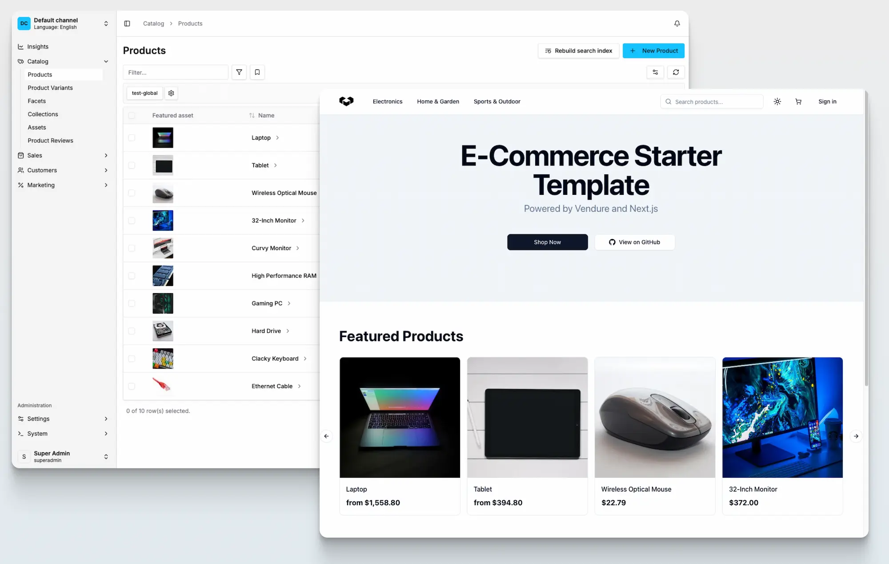

## Requirements

- [Node.js](https://nodejs.org/en/) **v22**, **v24** and **v26** - these versions are tested and supported. (Odd-numbered versions above v22 should still work but are not officially supported.)
  Vendure v4 requires Node.js v22.12 or newer. Node.js v20 reached end-of-life on 30 April 2026 and is no longer supported.
- [Docker](https://www.docker.com/products/docker-desktop/) or [Podman](https://podman.io/), to run the project. `vendure dev` starts a local PostgreSQL database and Redis cache in containers. Creating the project needs neither.

## @vendure/create

The recommended way to get started with Vendure is the [@vendure/create](https://github.com/vendurehq/vendure/tree/major/packages/create) tool. It writes a new project, installs its dependencies, and makes a git repository with an initial commit.

Run the following command in your terminal, replacing `my-shop` with the name of your project:

```bash
npx @vendure/create my-shop
```

Create asks a few questions:

- **Storefront**: whether to include an official [TanStack Start or Next.js storefront starter](/storefront/storefront-starters/). With a storefront, the project is a workspace: the Vendure server is in `apps/server` and the storefront in `apps/storefront`. The workspace installs from the root, so create leaves out the starter's `package-lock.json` and `.npmrc`, as well as its `.github/` folder and `.mcp.json`, which work only at the repository root. The starter's `AGENTS.md` stays in `apps/storefront`, and the root `AGENTS.md` points to it.
- **Base data**: the preset that the first `vendure dev` seeds into the database, for example `uk`, or `single-country` with your country and currency. A preset sets up the currency, tax rates, zones and shipping for a market.
- **Agent clients**: the AI coding assistants to set the project up for: Claude Code, Cursor, VS Code and Codex. Create writes `AGENTS.md`, the Vendure skills in `.agents/skills/`, and each client's MCP config with the `vendure` and `vendure-docs` servers.

Every question also has a flag, so you can create a project without prompts, for example from a script or a coding agent:

```bash
npx @vendure/create my-shop --yes --storefront nextjs --preset uk
```

Run `npx @vendure/create --help` to see all the options.

### What create writes

The project is a Vendure Cloud app. Its configuration is one file, `src/vendure-config.ts`, which calls `defineCloudConfig()`:

- `src/vendure-config.ts`: your plugins and settings.
- `src/migrations/`: the database migrations, empty until the first `vendure dev`.
- `.vendure/create.json`: a record of your choices, which `vendure dev` reads. Commit it.

There is no entry point, database configuration or Docker Compose file. `vendure dev` provides the database and the cache locally, and Vendure Cloud provides them when you deploy. To run Vendure on your own infrastructure instead, see [Self-hosting](/deployment/self-hosting).

### Start the server

Move into the new directory and start the local development environment:

```bash
cd my-shop

npm run dev
```

The first run starts PostgreSQL and Redis, writes the initial database migration into `src/migrations/`, and seeds the base data you chose. Commit the migration.

You should now be able to access:

- The Vendure Admin GraphQL API: [http://localhost:3000/admin-api](http://localhost:3000/admin-api)
- The Vendure Shop GraphQL API: [http://localhost:3000/shop-api](http://localhost:3000/shop-api)
- The Vendure Dashboard: [http://localhost:3000/dashboard](http://localhost:3000/dashboard/)

If you included a storefront starter, you can also access:

- The storefront: [http://localhost:3001](http://localhost:3001/)



Congratulations! 🥳 You now have a fully functional Vendure server running locally.

Now you can explore Vendure by following our [Try the API guide](/getting-started/try-the-api/) to learn how to interact with the server.

If you are new to GraphQL, you should also check out our [Introducing GraphQL guide](/getting-started/graphql-intro/).

:::tip
Open the Dashboard at [http://localhost:3000/dashboard](http://localhost:3000/dashboard) in your browser and log in with the local superadmin credentials:

- **username**: superadmin
- **password**: superadmin

:::

:::cli
Use `npx vendure add` to start adding plugins & custom functionality to your Vendure server.
:::

### Troubleshooting

- If you encounter any issues during installation, you can get a more detailed output by setting the log level to `verbose`:

    ```bash
    npx @vendure/create my-shop --log-level verbose
    ```

- If the install fails, fix the problem it reports, then run your package manager's install command in the project directory. Create writes `.vendure/create.json` before it installs, so your choices are kept.
- `npm run dev` fails with a container error when neither Docker nor Podman is running. Start one of them and run it again.
- If you want to use **Yarn**, you'll need **Yarn 2** (Berry) or above.
