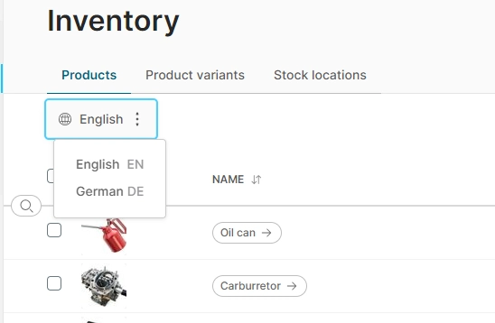

The global settings allow you to define certain configurations that affect _all_ channels.

* **Available languages** defines which languages you wish to make available for translations. When more than one language has been enabled, you will see the language switcher appear when viewing translatable objects such as products, collections, facets and shipping methods.
  

Inventory tracking and the out-of-stock threshold are set per channel. See [Channels](/user-guide/settings/channels#stock-settings).
